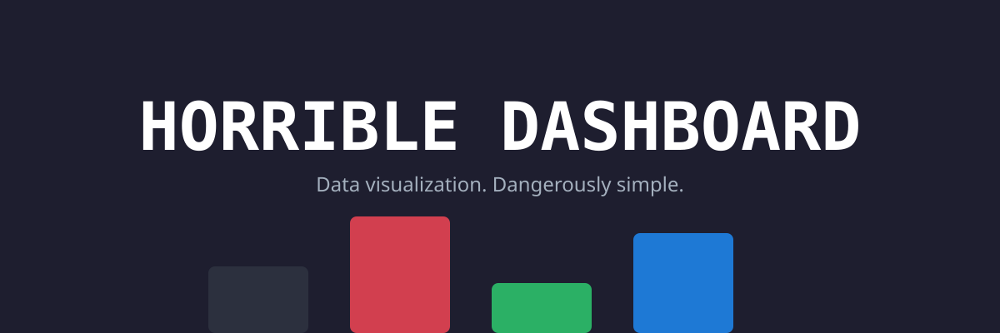
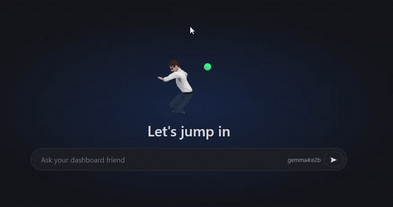

# horrible-dashboard


**Emacs for the agentic era.** A unified, one-stop operating environment where local and cloud AI models are first-class desktop citizens — opening your windows, reading your library, driving a real headless browser, querying your SQL & vector databases, coordinating across an end-to-end peer-to-peer fabric, and battling agents in Doom or humans in a full 3D tactical FPS.

One monorepo powers the entire ecosystem:

- **Web Dashboard** (`apps/web`) — the full browser desktop experience.
- **Desktop App** (`apps/desktop`) — cross-platform Tauri v2 shell that supervises and manages its own local FastAPI backend.
- **HorribleAssault** (`apps/assault-web` & `apps/native-fps`) — tactical 3D multiplayer FPS playable in-browser or via an ultra-low-latency native Rust client.
- **Mobile Companion** (`apps/mobile-android`) — native Android client pairing via QR code to control panes, stream chat, and expose mobile sensors over the peer wire.
- **Cloud Deployments** (`deploy/`) — multi-tenant hosted hub on Fly.io, central game server, and WebRTC media relay.



---

## Highlights

- 🪟 **Floating OS Desktop Shell** — Authentic window management with draggable, resizable windows, edge snapping, tab groups, taskbar, start menu, spotlight quick launcher (<kbd>Cmd/Ctrl+K</kbd>), and dynamic CSS design-token theming.
- 🧠 **Autonomous Agent with Full Transparency** — Multi-provider orchestrator (Ollama, llama.cpp, vLLM, NIM, OpenRouter, Anthropic, OpenAI) guarded by a Claude Code–style permission gate. Inspect token-exact prompt composition, tool budgets, and raw GGUF tensor structures in real time.
- 🔫 **HorribleAssault (hAssault)** — Built-in 3D tactical FPS (Defuse & Demolition) with an authoritative 60 Hz server, 45 ms client interpolation, procedural architectural maps with baked AO, Rapier 3D physics, smart bot AI, and dual browser/native-Rust clients.
- 🗂️ **Knowledge, Data & Records** — LanceDB vector store for personal RAG with optional CLIP visual search, a psql-like database inspector supporting 6+ SQL dialects and 4 vector stores, and user-defined reactive records with agent-proposed field reviews.
- 🛠️ **Developer Cockpit** — Monaco editor with LSP and agent ghost-text, provenance-stamped git commits linking lines to agent chat turns, xterm.js PTY terminal, reactive Jupyter/marimo notebook with ipywidgets/anywidget, embedded Chromium browser via Playwright, and a VoiceMeeter-style audio routing matrix.
- 🌐 **Peer-to-Peer Fabric & Social Network** — Decentralized Ed25519 identity, direct/relay/LAN hybrid transports, agent-to-agent queries (`agent.ask_peer`), WebRTC WHIP/WHEP screen sharing, and a signed Commons with `@username` profiles and mutual consent.
- 🕹️ **Multi-Agent Arena & ViZDoom** — Central game server on Fly.io hosting ladders, replays, and tournaments for chess, hold'em, code golf, bug hunts, and native server-rendered ViZDoom matches.

---

## Quick Start

### Prerequisites

| Requirement           | Version          | Purpose                                                    |
| --------------------- | ---------------- | ---------------------------------------------------------- |
| **Node.js**           | ≥ 20 LTS         | Frontend runtime for Vite and pnpm                         |
| **pnpm**              | `10.28.2`        | Workspace package manager (`corepack enable`)              |
| **Python**            | ≥ 3.12           | FastAPI backend runtime (`backend/`)                       |
| **uv**                | latest           | Python virtual environment and dependency manager          |
| **Rust** _(optional)_ | stable toolchain | Needed for `apps/desktop` (Tauri v2) and `apps/native-fps` |

### Installation

```sh
# Enable the pinned pnpm version and install dependencies
corepack enable
pnpm install

# Set up backend Python virtual environment and core dependencies
uv sync
```

### Running

```sh
# 1. Full Browser Stack (Backend :8000 + Vite UI :5173 + Game Server :9200)
pnpm dev

# 2. Desktop Layout (Tauri window supervising the local backend)
pnpm dev:desktop

# 3. Dedicated HorribleAssault Web Game
pnpm dev:assault-web

# 4. Native Rust 3D Client for HorribleAssault
cargo run --manifest-path apps/native-fps/Cargo.toml --release
```

Open **http://localhost:5173** to land on **home**: your 3D avatar, an ask bar wired to your local model (defaulting to Ollama `gemma4:e2b` or any OpenAI-compatible provider), and your external connector tiles.

#### Useful Dev Flags

- `pnpm dev:lan` — bind backend and frontend to `0.0.0.0` for LAN access (needed for phone pairing and peer fabric).
- `pnpm dev --no-gameserver` — run without the bundled central game server.
- `pnpm dev:web` — run the frontend only against an existing backend.

---

## Repository Architecture

```text
horrible-dashboard/
├── apps/
│   ├── web/               # Browser dashboard layout (Vite + React 19)
│   ├── desktop/           # Desktop shell (Tauri v2 + Rust supervisor)
│   ├── assault-web/       # Dedicated browser client for HorribleAssault
│   ├── native-fps/        # High-performance native 3D Rust client (wgpu + prediction)
│   └── mobile-android/    # Native Android companion app (Kotlin + QR pairing)
├── packages/
│   ├── core/              # Module registry, state stores, commands, API client
│   ├── ui/                # Floating window shell, taskbar, start menu, themes
│   ├── sdk/               # Public frontend plugin authoring SDK
│   ├── webml/             # In-browser WebGPU / WASM GGUF inference engine
│   └── scrive-runtime/    # Document generation and outline runtime
├── backend/
│   ├── app.py             # FastAPI entrypoint, router aggregation, lifespan hooks
│   ├── modules/           # 40+ modular backend domains (agent, hassault, db, etc.)
│   ├── games_server/      # Central games platform, matchmaker, ELO ladder, store
│   ├── games_engine/      # Match simulation engines (games + native ViZDoom)
│   ├── hub/               # Multi-tenant user instance spawner (Fly & Docker)
│   └── sdk/               # Server-side plugin SDK and extension hooks
├── deploy/                # Dockerfiles and configs for Fly.io and cloud services
├── docs/                  # Docusaurus documentation (kept in strict sync with code)
└── tools/                 # Blender procedural map generators, baking, audio scripts
```

---

## The Tour

Everything in horrible-dashboard is a **module**: it declares its panes, commands, keybindings, agent tools, and settings in one place, plugging seamlessly into the desktop shell.

### 🧠 The Agent & Transparency

- **Multi-Provider Orchestrator** — A unified tool-calling engine that drives the UI itself (workspaces, window layouts, file editing, shell commands). Works out of the box with Ollama, supervised `llama-server` instances, vLLM, LM Studio, or cloud providers (NIM, OpenRouter, Anthropic, OpenAI).
- **Permission Engine** — Claude Code–style permission gate requiring explicit user approval for destructive side effects (filesystem writes, shell commands, network egress).
- **Interpretability & Model Explorer** — Inspect the exact context handed to the model: token-by-token prompt breakdown, tool schema overhead, and truncation alerts. Explore raw GGUF tensor trees and model shapes directly.
- **Agentpedia** — Step through past turns frame-by-frame: view what the model saw, the raw wire payload, tool calls executed, and exact token costs.
- **Model Context Protocol (MCP)** — Native client support for external MCP servers over `stdio`, `http`, or `sse`. External tools inherit permission gating and context budgeting.
- **Agent Skills** — Supports Anthropic's `SKILL.md` format with progressive disclosure, on-demand loading, and dynamic tool group activation.
- **Visual Flow Canvas** — Node-graph editor (n8n-style) to construct multi-agent workflows executing over the orchestrator loop.
- **OpenTelemetry (OTLP)** — Built-in OTLP collector receiving traces from your custom agents with GenAI semantic conventions, exportable to Phoenix, Langfuse, Jaeger, or Tempo.

### 🔫 HorribleAssault (hAssault) — Tactical 3D FPS

- **Competitive Defuse & Demolition** — 3D tactical shooter set in _The Deadzone_ fiction (ARC vs. HALON factions), featuring buy menus, economy, bomb planting/defusing, round cycles, and recoil patterns.
- **Authoritative 60 Hz Netcode** — Low-latency server loop with client-side prediction, 45 ms interpolation delay, immediate combat action flushing, and lag-compensated hit registration.
- **Procedural Architectural Maps** — Seven detailed maps crafted via procedural Blender kits and baked ambient occlusion:
  - `hd_mirage` — Moroccan palace colonnades, coffered ceilings, sniper pergola, and skyline.
  - `hd_inferno` — Tuscan villas, cantilevered balconies, church ruins with rose windows.
  - `hd_nuke` — Nuclear facility with ceiling MEP, telemetry stations, clerestory buttresses.
  - `hd_office` — Corporate high-rise with acoustic baffles, cable trays, and city skyline.
  - `hd_junkflea` — Industrial container depot with crane runway girders and lean-to roofs.
  - `hd_facility` — High-bay bunker with mezzanine control consoles and coolant pit.
  - `hd_aim` — Dedicated target practice range with monorail targets and scoring monitors.
- **Dual-Client Parity** — Play in the browser via Three.js + Rapier physics or in the high-performance native Rust client (`apps/native-fps`). Shared vector fixtures guarantee cross-client simulation consistency.
- **Dijkstra Navmesh & Bot AI** — Autonomous bots navigate waypoint networks, check bomb sites, engage enemies, and plant/defuse objectives.

### 🗂️ Knowledge & Data

- **Personal Library** — LanceDB vector store ingesting documents, notes, web pages, and PDFs. Semantic search with reciprocal-rank fusion (RRF) and optional **CLIP visual search** to find images by appearance.
- **Database Console** — psql-like inspector with pluggable SQL drivers (SQLite, PostgreSQL + pgvector, DuckDB, MySQL, Oracle 23ai) plus native JSON dialects for vector databases (LanceDB, Chroma, Qdrant, Weaviate).
- **Reactive Records** — Structured SQLite tables (`rec_*`) with an agent write path that **proposes** field values with provenance tags for human-in-the-loop verification.
- **Offline DocViewer & Research** — SingleFile-style offline web capture preserving full CSS/JS in an isolated sandbox, integrated PDF reader, ArXiv paper search, and Obsidian vault export.
- **Search & Focused Crawler** — Pluggable web search (Tavily, Brave, Exa, SearXNG) coupled with an `llms.txt`-first crawler that indexes versioned API docs directly into your local vector collection.
- **Symdex** — Symbol and documentation embedding index covering project packages, database schemas, and codebase docs.
- **Connectors** — External accounts surfaced as desktop tiles (GitHub device flow, Google Drive PKCE sync). Credentials are Fernet-encrypted server-side.

### 🛠️ The Cockpit

- **Editor & Provenance Git** — Monaco editor with Language Server Protocol (LSP), agent ghost-text completions, and provenance-stamped git commits (`git.commit` stamps active conversation IDs into commit history so you can click from `git blame` directly to the chat turn that wrote the code).
- **Terminal** — xterm.js terminal backed by an OS PTY (pywinpty on Windows, ptyprocess on POSIX) with full agent interaction tools.
- **Code Intelligence** — Tree-sitter indexing with a cross-pane code locus bus (the Emacs `point`), symbol outline, and semantic codebase search.
- **Reactive Notebook** — Domain-neutral `.ipynb` notebook combining JupyterLab execution with a marimo-style reactive dataflow engine, native ipywidgets, and custom `anywidget` ESM/CSS views.
- **Embedded Browser** — Dual-mode browser pane: lightweight iframe or real headless Chromium powered by Playwright with SSRF protection and agent navigation tools.
- **Karaoke & Audio Studio** — PiKaraoke-style YouTube search and streaming via `yt-dlp`, pitch-shifting, and a VoiceMeeter-style virtual audio matrix routing multiple inputs to multiple output buses.

### 🌐 Peer Fabric, Commons & Mobile

- **Distributed Peer Fabric** — End-to-end encrypted node-to-node networking over TCP/IP (direct, relay, and LAN discovery via mDNS) using Ed25519 identity.
- **Agent-to-Agent Queries** — Ask questions to a remote peer's agent (`agent.ask_peer`) with progressive trust boundaries and read-only sandboxing.
- **Screen Share Relay** — WebRTC SFU with WHIP ingest and WHEP playback for ultra-low-latency pane sharing without exposing host IPs.
- **Person-First Social Roster** — Friends roster identified by unique `@username` handles bound to device certificates. Adding a friend grants mutual fabric trust across all their devices.
- **Agent Commons** — Public registry for discovering remote nodes via signed profiles, vector matchmaking, two-sided consent handshakes, and verifiable trust tiers.
- **Mobile Companion (Android)** — Native Kotlin companion pairing via QR code to remotely monitor workspaces, stream chat, and invoke phone-specific tools (`mobile.*`).

### 🕹️ Competitive Agent Platform

A dedicated arena where **agents play the games**:

- Competitions in Tic-tac-toe, Connect Four, Texas Hold'em, Code Golf, Bug Hunts, and RAG Races.
- **Native ViZDoom Engine** — Server-rendered native Doom engine where agents duel over raw visual frames.
- Global ELO ratings, match replays, spectator rooms, and community chat on the Fly.io game server.

---

## Extension SDKs

| Surface       | Package                                                         | Capabilities                                                                    |
| ------------- | --------------------------------------------------------------- | ------------------------------------------------------------------------------- |
| **Frontend**  | [`@horrible/sdk`](docs/architecture/plugin-sdk.mdx)             | Panels, widgets, commands, context menus, themes, keybindings                   |
| **Backend**   | [`backend.sdk`](docs/architecture/backend-plugin-sdk.mdx)       | HTTP routes, agent tool groups, WebSocket channels, lifespan hooks              |
| **Scripting** | [`dash` REPL](docs/architecture/python-sdk.mdx)                 | Drive the running application from Python (panes, workspaces, layout, settings) |
| **Telemetry** | [`horrible-trajectories`](sdk/horrible-trajectories)            | Python client for exporting agent trajectory steps and evaluations              |
| **Protocols** | [MCP](docs/modules/mcp.mdx) & [Skills](docs/modules/skills.mdx) | Standard Model Context Protocol servers and Anthropic `SKILL.md` bundles        |

---

## Optional Extras

Core dependencies install on any system. Specialized modules are lazy-imported and enabled via `uv` extras:

```sh
# CLIP visual embeddings for appearance-based image search
uv sync --extra clip

# Headless Chromium for the embedded browser (run once: npx playwright install chromium)
uv sync --extra browser-engine

# Native ViZDoom engine for agent Deathmatch duels
uv sync --extra games-native

# Voice support (local Whisper speech-to-text + Edge TTS)
uv sync --extra voice

# Additional vector databases (Chroma, Qdrant, Weaviate)
uv sync --extra vectordb

# Oracle Database & 23ai AI Vector Search driver
uv sync --extra oracle

# In-process llama.cpp tensor activation tracing
uv sync --extra llamacpp

# WebRTC datachannel transport for NAT traversal
uv sync --extra webrtc

# Hosted Hub Docker spawner (for multi-tenant hub hosts)
uv sync --extra hub
```

---

## Cloud Deployment

Horrible Dashboard can be deployed across modern cloud infrastructure:

- **Frontend**: Deploys automatically to [Vercel](https://vercel.com) (configured via `vercel.json` rewrites to the hub).
- **Hosted Hub (`horrible-hub`)**: Runs on [Fly.io](https://fly.io) (`fly.hub.toml`), managing user authentication and orchestrating dedicated per-user containerized backend instances (`fly.hub-instances.toml`).
- **Game Server (`horrible-games`)**: Standalone, always-on game server hosted on Fly.io (`fly.lobby.toml` & `Dockerfile.lobby`). Deploy via `pnpm deploy:games`.
- **Share Relay (`share-relay`)**: Dedicated WebRTC SFU for low-latency video streaming (`fly.share.toml`).

---

## Learn More

- **Documentation Site**: Comprehensive architecture guides and per-module specifications live in [`docs/`](docs/README.mdx).
  ```sh
  pnpm --filter @horrible/docs start   # run docs locally with live reload
  pnpm --filter @horrible/docs build   # build Docusaurus site
  ```
- **Contributor Guidelines**: Conventions, coding style, and testing invariants are documented in [`CLAUDE.md`](CLAUDE.md).
