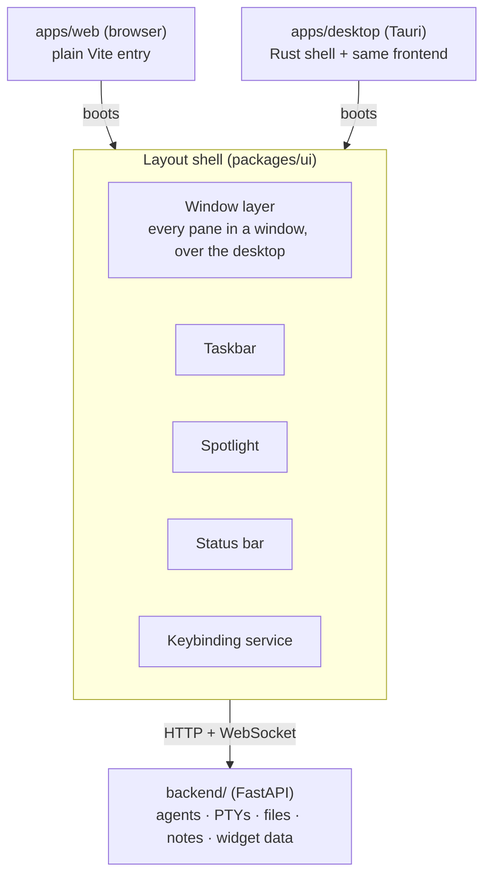

# Layout shell: one frontend, two layouts

The browser app and the desktop app render the **same React frontend**. There is
no per-platform fork of the UI. The differences between the two are confined to
(a) the app entry that boots the shell and (b) the platform capabilities exposed
to modules.



## Implementation status

Implemented: module registry, spotlight (Ctrl+K), keybinding service
(`mod+` prefix), capability service, and both entries (`apps/web` on port 5173
proxying `/api` and `/ws` to the backend on port 8000; `apps/desktop` Tauri shell
loading the same dev server). The shared `/ws` socket is consumed via a single
multiplexed client (`packages/core/src/ws.ts`, channel subscriptions + `sendChannel`)
— its users are the observability `telemetry` channel (see
[../modules/observability.md](../modules/observability.mdx)) and the `agent`
channel that drives the agent orchestrator (see
[../modules/agent-chat.md](../modules/agent-chat.mdx)). The backend `/ws` handler
is a bidirectional router: telemetry pushes outbound while one receive loop
dispatches inbound channel messages.

The shell has exactly **one** main view. `ShellView` is `'boot' | 'oobe' |
'desktop'`, and the first two are the states before you arrive at it.

That is a change from the original two-view design. The `workspace` view (a tiling
frame) is gone along with tiling itself — see
[desktop-shell.mdx](desktop-shell.mdx#one-desktop-no-tiling) — and:

- **`home` was a second landing screen** competing with the desktop for the same
  job. It survives as the `splash` **backdrop** — same avatar, greeting and ask bar,
  now with windows able to float over it. `shell.home` still exists and still means
  "take me to the landing surface"; the destination is now the desktop.

Installing the layout engine is correspondingly a **shell** job rather than the
frame's: `packages/ui/src/layout/install.ts` installs the LayoutController, binds the
autosave, registers the `frame` module's commands and hydrates the desktop. That
used to live in the tiling frame's mount effect, which worked only while the frame
was the only place you could be — once the desktop became the landing surface a
fresh boot installed none of it, and every one of those failures was silent.

See [desktop-shell.mdx](desktop-shell.mdx) for the desktop, its backdrops, the
taskbar and the boot flow.

What survived from the old `home` view is the avatar
(`packages/core/src/Avatar3D.tsx` — moved to core so feature modules like the agent
chat pane can use it too). It is a
  rigged glTF character (`/my-avatar.glb`) loaded with three's `GLTFLoader`,
  with pointer-tracking. It expresses the agent's **emotional mood** as a looping
  animation: the `moods` prop maps mood names to animation clips
  (`DEFAULT_AVATAR_MOODS` — `happy → /dancing.glb`, `flair → /flair.glb`,
  `error → /falling-over.glb`, all in `apps/web/public/`) and the `mood` prop
  selects the active one, cross-fading on change. Adding a mood is one `.glb`
  plus one line in the map. Orbiting the avatar is **Dashy**, the dashboard
  mascot — a cute glowing orb with eyes that face the viewer, whose glow doubles
  as the agent status light. three is dynamically imported so a desktop not
  showing the `splash` backdrop never loads it.

Every pane opens in a **window**; a window can hold several panes as tabs, and
region strips run down a pane's own sides. See [windowing.mdx](windowing.mdx) for the
model, roles, pane types vs instances, and persistence. Panes are opened from the
spotlight, the Start menu, a command, or the agent. The **minibuffer** floats above
the taskbar — `alt+x` for slash commands, and where `dialogs.prompt()` renders (see
[windowing.mdx](windowing.mdx#the-minibuffer)).

The **window layer** sits over the view as a sibling of it, not inside it, so windows
do not vanish when the view is hidden (`.shell-view[hidden]` is `display: none`). It
is bounded by `.shell-content`, which keeps a window titlebar from sliding under the
native titlebar and its Tauri drag region — and the taskbar sits outside
`.shell-content`, so a maximized window cannot cover it. See
[desktop-shell.mdx](desktop-shell.mdx).

Branding: source art lives in `assets/` (`logo.svg`, `banner.svg`) —
`pnpm build:icons` regenerates the web favicon (`apps/web/public/favicon.ico`,
16/32/48), the SVG favicon copy, and the Tauri app icons (full size set) from
`assets/logo.svg`. `assets/banner.svg` is the README banner.

## The workspace

The shell owns the desktop: panes in windows, persisted as one layout. Modules never
render themselves into the DOM directly — they **register panels** with the module
registry (`packages/core`), and the shell decides where panes live (a window, placed
where that view was last left; the user can rearrange freely).

A pane body is **loaded when it first renders, not at boot.** Every manifest is
registered before the shell paints, so a component a manifest imports statically is
parsed on every launch whether or not its pane is ever opened — which is how three.js,
Rapier, Agora, pdf.js, xterm, xyflow, MUI and CodeMirror all used to load up front.
Manifests declare `component: lazyPane(() => import('./Panel'), 'Panel')` instead, and
`PaneHost` (and a board tile, and a settings section) renders it under `<Suspense>`.
The rule that makes it work: the file behind the `import()` must not *also* be
imported statically from anything on the boot path — a barrel re-export counts —
or the bundler has nothing to split and the pane quietly stays eager. The production
entry is ~0.8 MB (from 3.0 MB, plus eight vendor chunks that are no longer preloaded),
and `pnpm dev` loads ~430 modules at boot instead of ~1,500.

The one bundler trap: Vite's `__vitePreload` helper is shared by every dynamic
import, and Rollup hoists it into whichever `manualChunks` chunk used it first. It
landed in `vendor-codemirror` (via language-data), so the entry preloaded all of
CodeMirror to call a 1 KB helper. `apps/web/vite.config.ts` pins it to its own
`runtime` chunk.

Everything user-facing routes through two shell services:

- **Spotlight** (`mod+k`) — every module capability is a registered command
  (`module.verb` ids, e.g. `terminal.new`, `chat.focusInput`). Panels' buttons
  invoke commands; the spotlight and keybindings invoke the same commands. This is
  what keeps both layouts behaviorally identical. The spotlight also searches open
  panes and falls through to the **agent** when nothing matches, so one keystroke
  covers ask, run and open — see
  [desktop-shell.mdx](desktop-shell.mdx#spotlight).
- **Keybinding service** — maps keys to command ids, conditioned on the focused
  pane and on whether a pane has captured the keyboard. Modules declare defaults,
  the user can rebind anything, and on desktop it registers OS global shortcuts.
  Fully documented in [keybindings.mdx](keybindings.mdx); the summary below is
  just the frame's own defaults.

### Keybindings

A `KeybindingDecl` is `{ key, command }` plus optional `when` (a condition over a
closed context-key vocabulary), `override`, `hosts`/`platforms`, and `global`.
Precedence is **capture gate → user override → `override: true` → most specific
`when` → registration order**. Key specs are `+`-separated modifier tokens plus
the key (`mod+k`, `alt+shift+left`, `mod+k mod+s` for a sequence, `code:KeyW` for
a physical key).

Focus lives in `frame.focusedInstanceId`; a pane that needs the whole keyboard
takes **capture**, and Escape unwinds through one ordered ladder. All of that,
plus host-reserved chords and the `keymap.*` agent tools, is in
[keybindings.mdx](keybindings.mdx). (CodeMirror/xterm keep their own internal
keymaps; this service is for registry command bindings.)

### Default desktop keybindings

| Key | Action |
| --- | --- |
| `t` / `n` / `b` | toggle the focused pane's left / right / bottom **region** strip |
| declared letters (`o`, `s`, `g`, …) | reveal that region view on the focused pane |
| `ctrl+space` (Linux) · `mod+alt+f` (mac/Windows) | present the focused window's pane over the whole screen |
| `f11` (desktop only) | toggle native OS-window fullscreen. Desktop-only because `f11` is browser-owned and **unpreventable** — the browser layout reaches app fullscreen through the tray control instead |
| `alt+arrows` | focus the nearest window in that direction |
| `alt+grave` / `alt+shift+grave` | next / previous window |
| `mod+shift+arrows` | snap the focused window to a half (top maximizes) |
| `mod+alt+s` then a key | snap palette: corners, centre, thirds — see [desktop-shell.mdx](desktop-shell.mdx#the-snap-palette) |
| `mod+alt+up` / `mod+alt+down` | maximize / minimize the focused window |
| `mod+k` | spotlight — ask, run a command, or jump to a pane (a focused pane may shadow it — the terminal binds it to `terminal.clear`) |
| `alt+x` | minibuffer / M-x — slash commands (`override`, never shadowable) |
| `mod+k mod+s` | Keyboard Shortcuts pane |

Two of those rows split by host or platform for a reason: `f11` is browser-owned,
and `ctrl+space` is the IME toggle on Windows and the input-source switch on macOS.
Both are in the reserved table, and the Shortcuts pane flags any binding that lands
on one.

## Platform capability service

Modules must never check `window.__TAURI__` or user-agent sniff. `packages/core`
exposes a capability service; feature code branches on capabilities and degrades
gracefully:

| Capability             | Browser                            | Desktop (Tauri)                  |
| ---------------------- | ---------------------------------- | -------------------------------- |
| `fs.nativeDialogs`     | no (backend workspace roots only)  | yes (native open/save dialogs)   |
| `shell.revealInOS`     | no                                 | yes                              |
| `notifications.system` | Web Notifications (tab-scoped)     | OS notifications                 |
| `window.multi`         | no (single tab, pop-out = new tab) | yes (panel pop-out to OS window) |
| `window.fullscreen`    | **yes** (DOM Fullscreen API; tray control, no F11) | **yes** (native OS-window fullscreen; F11 or the titlebar control) |
| `chrome.workspaceTabs` | no (the page is already in a window) | **yes** (undecorated window; the app draws the titlebar) |
| `shortcuts.global`     | no                                 | **yes** (`global: true` bindings registered with the OS) |
| `tray`                 | no                                 | yes                              |
| `media.displayCapture` | **yes**                            | **Windows/Linux only** — WKWebView on macOS exposes `getDisplayMedia` and rejects it |

`media.displayCapture` is the one row that is **not** uniform across the desktop,
which is why the shell calls `desktopCapabilities(platform)` rather than handing
over the flat `DESKTOP_CAPABILITIES` list. It is also the one capability that
exists *because* feature detection cannot answer the question: WKWebView exposes
`navigator.mediaDevices.getDisplayMedia` and then rejects the call with
`NotAllowedError` — byte-identical to the host dismissing the picker — so a probe
would report "available", the share would fail, and the UI would correctly stay
silent about what it read as a cancel. Everything else about capture is still
feature-detected; see [the share module](../modules/share.mdx).

The `window.*`/`chrome.*` rows are the contract for the native shell (an
app-drawn titlebar, OS fullscreen). They exist in the `Capability` union so the
shell can branch on them. The Tauri shell grants these through `DESKTOP_CAPABILITIES`, and the
desktop entry wires a `WindowControl` seam (`packages/core/src/window.ts`) to
the shell's `window_*` commands (`apps/desktop/src-tauri/src/window.rs`).
Shipped so far:

- **`window.fullscreen`** — `shell.toggleFullscreen` takes the whole app
  fullscreen, distinct from presenting a pane in-window. It is granted in **both** layouts: `toggleAppFullscreen`
  (`core/fullscreen.ts`) drives the native OS window through the `WindowControl`
  seam where there is one, and the DOM Fullscreen API where there is not. The
  **key** is native-only — `keymap/reserved.ts` declares `f11` browser-owned with
  `preventable: false`, so binding it in a tab yields a binding that silently
  never fires. The tray's `⛶` button is what makes the feature reachable in the
  browser.
- **`chrome.workspaceTabs`** — the desktop window is **undecorated**
  (`decorations: false`) and `TitleBar.tsx` is its titlebar: a native
  `data-tauri-drag-region` (moves the window, maximizes on double-click, handled in
  the webview), the min/maximize/close controls (`WindowControls`), and invisible
  edge grips (`WindowResizeHandles`) that drive OS edge-resize since the window has
  no native borders. The name is the workspace tab strip's, which used to be that
  titlebar.
Both ship. (`window.perWorkspace` — a workspace in its own OS window — was removed
with the workspaces.)

The `window_*` custom commands are ACL-gated like any command here: each needs a
permission in `apps/desktop/src-tauri/permissions/` listed in
`capabilities/default.json` (the `data-tauri-drag-region` additionally needs the
core `window:allow-start-dragging` / `window:allow-internal-toggle-maximize`
permissions). Wiring a new native capability follows this same path: grant it in
`DESKTOP_CAPABILITIES`, add the Tauri command(s) + their permission, extend the
relevant host seam,
and gate the feature on `hasCapability(...)` so the browser degrades cleanly.
The desktop build claims `DESKTOP_CAPABILITIES` (vs the browser's
`BROWSER_CAPABILITIES`) via the `isTauri()` branch in `apps/web/src/main.tsx`.

The commands take **`tauri::Window`** (or `tauri::Webview` for page zoom), never
`WebviewWindow`. Tauri resolves a `WebviewWindow` argument only while the window
holds a single webview, and every native browser pane adds a child webview — so
with a Browser pane open, a `WebviewWindow` command is rejected ("current webview is
not a WebviewWindow") and the titlebar buttons and F11 silently do nothing. For the
same reason, look a window up with `app.get_window(label)`, not
`get_webview_window`, which returns `None` for such a window.

## Backend connection

Both layouts talk to the same FastAPI backend over HTTP + WebSocket, through one
origin switch (`packages/core/src/origin.ts`, set once at boot via
`initBackendOrigin`):

- **Browser:** origin stays `null` — paths are relative (`/api`, `/ws`) and the
  Vite dev server proxies them to `localhost:8000` over a **keep-alive** agent.
  Without one, http-proxy sends `Connection: close` and relays it back, so every
  API call opened a new TCP connection to the dev server — and on Windows a new
  connection to `localhost` costs ~250ms, because the IPv6 attempt is refused
  before IPv4 is tried (Vite listens on `127.0.0.1`). Start the backend yourself
  (`scripts/dev-backend.ps1` or `uv run uvicorn backend.app:app --port 8000`).
  Anything that executes on the backend (terminals, file access, agents) runs
  **where the backend runs**, not where the browser runs. Module docs call this
  out where it matters.
- **Desktop:** the Tauri shell **spawns and supervises the backend itself**
  (`apps/desktop/src-tauri/src/backend.rs`). On launch it locates the repo
  checkout, reuses an already-running backend on `:8000` if there is one
  (dev-backend.ps1 coexistence; it must answer `GET /api/health` as
  `horrible-dashboard`, so a stranger holding the port is skipped rather than
  adopted), otherwise picks a port (8000 preferred, ephemeral fallback) and
  spawns uvicorn bound to `127.0.0.1` — via the repo's
  `.venv` python when present, else `uv run` — with MinGW dirs stripped from the
  child PATH (the `no OPENSSL_Applink` crash). It restarts the process with
  backoff if it dies (3 fast failures → `failed` with the stderr tail) and kills
  it on app exit. The frontend polls the `backend_status` Tauri command at boot
  and uses **absolute** http/ws URLs from then on — no Vite proxy in the loop,
  so dev and packaged builds exercise the same path. If the backend never comes
  up, boot proceeds pluginless; the boot splash records the failed step and the
  taskbar's tray shows the backend as offline.

A packaged desktop build has no repo checkout: the supervisor reports
`unavailable`, which is the plug point for a future bundled/downloaded runtime
(python-build-standalone). A per-session auth token between shell and backend is
a planned follow-up — today anything on localhost can reach the API.

The shell owns a single multiplexed WebSocket connection with reconnect/backoff;
modules subscribe to channels on it rather than opening their own sockets.

## Toast notifications

The layout shell contributes a global **Toast Notification System** for displaying non-blocking, transient visual alerts (success, info, warning, error) that slide in from the top-right corner. It is designed to be usable by any module or plugin to announce background events (such as peer connections, file exports, or network status changes).

* **Store (`toastsStore`)** — lives in `packages/core/src/toasts.ts` (exported as `toastsStore` and type `Toast` from `@horrible/core`). Operates as a simple pub/sub store with React `useSyncExternalStore` support:
  * `toastsStore.add(type, title, message, duration?)` — triggers a new notification. Default duration is 4 seconds (`4000`ms); set to `0` or negative to keep it persistent until closed.
  * `toastsStore.remove(id)` — clears a notification by its unique ID.
* **Component (`Toasts`)** — lives in `packages/ui/src/Toasts.tsx` (rendered in the global `AppShell` layout overlay). Uses glassmorphism styling (`backdrop-filter: blur(12px)`) and cubic-bezier transition slide animations defined in `packages/ui/src/styles.css`.

### Usage Example
```typescript
import { toastsStore } from '@horrible/core';

// Success notification
toastsStore.add('success', 'File Exported', 'Workspace layout successfully saved to disk.');

// Error notification with persistent display
toastsStore.add('error', 'Sync Failed', 'Failed to connect to the peer fabric.', 0);
```

## Modal dialogs (prompt / confirm)

Toasts **inform**; dialogs **ask**. The shell contributes a promise-based modal
system that replaces the browser's `window.prompt` / `window.confirm` (which are
unstyled, untestable, and block the whole tab). No module calls the native dialogs
anymore — they all route through here, so input and confirmation look and behave
the same in both layouts.

- **Store (`dialogsStore` / `dialogs`)** — `packages/core/src/dialogs.ts`,
  exported from `@horrible/core`. Requests **queue** (one shown at a time) and each
  returns a promise:
  - `dialogs.prompt({ title, message?, defaultValue?, placeholder?, confirmLabel?, cancelLabel? })`
    → `Promise<string | null>` (null on cancel).
  - `dialogs.confirm({ title, message?, confirmLabel?, cancelLabel?, danger? })`
    → `Promise<boolean>`. `danger: true` renders the confirm button red for
    destructive actions (delete).
- **Component (`Dialogs`)** — `packages/ui/src/Dialogs.tsx`, mounted in `AppShell`
  beside `<Toasts />`. Renders the active dialog centered over a dimmed backdrop;
  Enter submits, Escape and backdrop-click cancel, the field auto-focuses. Styles
  (`.dialog-*`) live in `packages/ui/src/styles.css`.

Outside React (commands, CodeMirror keymaps) call `await dialogs.prompt(...)`
directly; where a handler must return synchronously (e.g. an editor keymap), fire
the promise and act in `.then(...)`. Pair the result with a toast for feedback —
e.g. confirm a delete, then `toastsStore.add('info', 'Deleted', …)`.

### Usage Example
```typescript
import { dialogs, toastsStore } from '@horrible/core';

const name = await dialogs.prompt({ title: 'New workspace', confirmLabel: 'Create' });
if (name?.trim()) {
  await createWorkspace(name.trim());
  toastsStore.add('success', 'Workspace created', `“${name.trim()}” is ready.`);
}

const ok = await dialogs.confirm({
  title: 'Delete file',
  message: "This can't be undone.",
  confirmLabel: 'Delete',
  danger: true,
});
if (ok) await remove();
```

## What belongs in each entry

- `apps/web`: boot the shell, resolve the backend origin (Tauri: ask the shell's
  `backend_status` command; browser: relative + proxy), register the browser
  capability set. Nothing feature-specific.
- Boot is **async**: after registering built-in modules, the entry awaits
  `loadPlugins()` (installed marketplace plugins, see
  [plugin-sdk.md](plugin-sdk.mdx)) before the first render, so restored layouts
  find plugin panels/widgets already registered. If the backend is down, boot
  proceeds without plugins.
- `apps/desktop`: same boot, plus Tauri-only wiring — window chrome, tray, global
  shortcuts, multi-window pop-out, native menu that dispatches to the same
  command registry. Rust code in `src-tauri/` stays a thin shell; app logic
  belongs in the backend or `packages/`.
