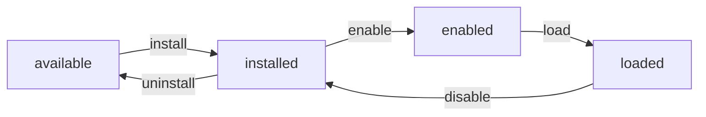

# Module packages

A **module package** is one feature (a pane or a set of panes, its backend routes,
its agent tools) as a self-contained directory. It can be enabled, disabled,
installed and uninstalled from the Marketplace **while the app runs**, without a
page reload. Its directory carries no dependency on where it lives, so it can move
to a repository of its own and come back as a git submodule with no code change.

Karaoke is the first built-in that has moved (`modules/karaoke`). Most panes are
still in-tree modules under `packages/core/src/modules`; they move in batches.

## Layout

```
modules/<id>/
  horrible-module.json     the contract (schema: packages/sdk/schema/horrible-module.schema.json)
  web/                     @horrible-module/<id>   src/index.ts exports `module`
  py/                      horrible-mod-<id>       src/horrible_mod_<id>/__init__.py exposes `MODULE`
  assets/                  optional, shipped with the Python half
  README.md
```

`horrible-module.json` is a superset of the older `horrible-plugin.json`
(`ModulePackageManifest` in `packages/sdk/src/module.ts`, mirrored by
`backend/sdk/module_manifest.py`). The fields that matter most:

| Field | Meaning |
| --- | --- |
| `id` | Lowercase kebab-case. Must equal the directory name. |
| `web.entry` | Source entry, relative to the package root (`web/src/index.ts`). |
| `py` | `root` (added to `sys.path` if the package is not importable), `package`, `entry` (`pkg:ATTR`). |
| `dependsOn` | Other modules that must load first. Disabling one of those is refused while this is loaded. |
| `provides` / `requires` | Service contract ids such as `audio.mediaStrip@1`. Load order follows provider before user. |
| `toolGroups` | Every agent tool the module registers must be `group.name` for one of these. The description is what the agent reads in `list_tool_groups`. |
| `panes` | View ids. A saved layout that holds one while the module is off shows an **Enable** placeholder instead of dropping the pane. |
| `standalone` | The pane `horrible run` (planned) renders full-window. |

A v3 `horrible-plugin.json` still loads unchanged: `normalizeManifest` reads either.

## What a module may import

| Half | Allowed |
| --- | --- |
| Web | `@horrible/kernel`, `@horribledashboard/sdk`, its own files |
| Python | `backend.kernel`, `backend.sdk`, its own package |

Anything another module owns is reached through a **typed service**, never an
import. The contract types live in `packages/sdk/src/contracts.ts`
(`ServiceContracts`). A provider calls `ctx.provide(key, impl)` in `activate`; a
user calls `registry.getService(key)` and copes with `undefined`. Karaoke uses the
audio module's `audio.mediaStrip@1` this way, and plays straight to the system
output when audio is off. The Python twin is `host.provide` / `host.require`.

`@horrible/kernel` re-exports from `@horrible/core/kernel-surface`, the leaf files
only. Going through the core barrel would pull every built-in into a module's
tests and its bundle chunk, including modules that do work at import time.

The rule is enforced in two places. ESLint `no-restricted-imports` on
`modules/*/web/**` covers the web half. `scripts/module-boundaries.mjs`
(`pnpm check:boundaries`) is a ratchet: it counts deep cross-module imports across
the whole repo and fails if the count rises above
`scripts/module-boundaries.baseline.json`. Lower the baseline with `--update` as
modules migrate.

## Lifecycle



Enabled is the default. The backend persists a **blocklist**
(`modules-state.json` in the data dir), so a newly shipped built-in starts on.

**Backend** (`backend/kernel/module_manager.py`). Discovery looks in four places:
the repo's `modules/`, `HORRIBLE_MODULES_PATH`, `modules/` in the data dir
(installed), and the `horrible.modules` entry-point group. A module's `setup(host)`
runs against a `ModuleHost`, which records an owner for everything it adds:
routes, agent tools, services, startup and shutdown hooks, background tasks, `/ws`
disconnect hooks. Unloading removes exactly that set and cancels the tasks.
Python cannot un-import code, so a re-enable re-runs `setup` on a fresh host in the
same process; keep long-running work in `host.background(...)`.

Routes are mounted by `RouteMounter`, which adds them to the app's own router and
removes them on unload. The plan called for a dispatcher sub-app; mutating the
router instead keeps the app's middleware and exception handlers in front of
module routes with no extra layer. A path and method that collides with an
existing route refuses the whole module. `/api/karaoke/*` URLs did not change.

Every change is broadcast on the `/ws` `modules` channel, and `GET /api/modules`
lists the state. `PUT /api/modules/{id}/enabled`, `POST /api/modules/install` and
`DELETE /api/modules/{id}` change it; a refusal (a dependent is loaded, a route
collides) is a 409.

**Frontend** (`packages/core/src/module-packages/`). Built-in web halves are
bundled through the Vite virtual module `virtual:horrible-modules`
(`packages/sdk/src/vite-modules.ts`): one code-split `import()` per manifest. The
loader follows the backend's `enabled` flags. For a module that turns off,
`registry.unregister(id)` does four things in order:

1. Closes the module's open panes through `closePaneGuarded`. A pane that vetoes
   (unsaved work) aborts the unload.
2. Runs the `activate` disposers.
3. Withdraws the services the module owns.
4. Bumps the registry generation, so the agent manifest is pushed again.

Third-party plugins (Blob-URL bundles) now go through the same path, so the
Marketplace's "Reload now" banner shows only when a change could not apply live.

## The agent

A module's tools reach the agent exactly like any other backend tool, grouped
under the module's `toolGroups`. They are never always-on unless the manifest says
so (the always-on core has a budget, see [Agent tools](agent-tools.mdx)), and the
group's catalog line comes from the manifest. Disable the module and the group
disappears from `list_tool_groups`; enable it and it is back.

## Tests

A module's tests live with it and run from wherever it is checked out:

```bash
pnpm --filter @horrible-module/karaoke test
uv run --no-sync pytest modules/karaoke/py/tests
```

`py/tests/conftest.py` is self-contained. It puts `py/src` on the path and isolates
the node's data, config and cache roots; it does not lean on
`backend/tests/conftest.py`. The root `pytest` run includes `modules` in its
`testpaths`.

## Packaging

The desktop runtime build (`scripts/build-backend-runtime.mjs`) copies each
package's `horrible-module.json`, `py/` and `assets/` (no tests). The
`deploy/dashboard-node` image copies `modules/`, and `.dockerignore` keeps the web
halves and tests out of it.

## Running a module on its own

```bash
pnpm horrible run karaoke            # or: uv run --no-sync python -m backend.cli run karaoke
pnpm horrible modules list
pnpm horrible bus ls
```

`horrible run <id>` starts a **slim backend** (`backend/kernel/slim_app.py`) that
hosts only the named modules and what they depend on, plus the **module shell**
(`apps/module-shell`), which renders the module's `standalone.pane` full-window
through the same `PaneHost` the desktop uses. The pane's region strips become
columns, and stack under the pane in a narrow window. `--ui dist` serves a built
shell from the backend, `--ui dev` starts Vite for it, and `auto` picks dist when
it has been built. `--port 0` picks a free port.

A runner shares the node's data dir with the dashboard. Settings are the same
settings, and that shared directory is how the processes find each other.

On Windows the runner puts itself in a kill-on-close Job Object before it spawns
Vite. However it ends (Ctrl+C, a crash, Task Manager), its children end with it.

## The module bus

Every process that hosts modules (the dashboard and each runner) does three things
(`backend/kernel/bus_node.py`):

1. **Publishes** `bus/proc-<pid>.json` in the data dir every 5 seconds. The record
   holds its port, a per-process token, the modules it hosts, their tool groups and
   a hash of their tools.
2. **Serves** those modules' agent tools over MCP at `/bus/mcp`
   (`module_mcp.py`). The endpoint is bearer-token gated and only answers on
   loopback; the SDK's DNS-rebinding protection rejects a non-loopback `Host` or
   `Origin`. It exposes only tools owned by modules loaded *in that process*, so
   calls never relay onward and cannot loop between peers.
3. **Mirrors** every peer's tools into its own registry (`bus_bridge.py`),
   re-listing a peer only when its tool hash changes.

A mirrored tool keeps its name (`karaoke.status`), so it lands in the same group
the module has in-process. The agent sees one `karaoke` group with the manifest's
description, wherever karaoke runs. Mirrors always carry a group, so peers never
grow the always-on tool set. A mirror keeps `side_effect` from the peer's
`destructiveHint`, so the calling process's permission gate asks before the call
leaves.

A record is live only while its heartbeat is under 15 seconds old **and** its pid
still belongs to the process that wrote it. The record stores the writer's process
create time because Windows reuses pids. A killed runner's group disappears from
the dashboard within seconds.

Any MCP client (Claude Code, MCP Inspector) can call a process's tools with the URL
and token from `pnpm horrible bus ls --json` (the token is in the record file).

### One owner per module

A module's state lives in exactly one process. Before a module's setup runs, its
process takes an atomic claim on it: `bus/claim-<id>.json`, created with `O_EXCL`.
A process that finds a live holder defers the module; the error names the holder,
and so do the pane placeholder and the runner's page. When the holder lets go (the
dashboard disables karaoke, or the runner stops), the waiting process loads it
without a restart.

The claim is separate from the record on purpose. Records are published from the
app lifespan, *after* modules load, so two processes starting together would both
have checked the bus, found nobody, and both loaded the module. That race was found
live.

In a runner, "enabled" means "a module this runner was started for". The shared
enable list is ignored there, because disabling karaoke in the dashboard is exactly
how you hand it to the runner.

The frontend registers a module's web half only when its backend half is loaded in
*that* backend. A dashboard whose karaoke is running standalone shows the
placeholder ("is running in karaoke (pid N)"), not panes that would get 404s.

Set `HORRIBLE_BUS=off` to keep a process off the bus. The backend test suite does
this.

## Still to come

- **Remote panes:** a dashboard could show karaoke's panes while karaoke runs
  standalone, by proxying `/api/karaoke/*` to the owner and relaying its `karaoke`
  `/ws` channel. Today the pane shows where the module is running instead.
- **Frontend-only tools in a runner:** the runner serves backend tools. A tool a
  module implements in the browser needs the agent relay in the shell.
- **Hassault** moves next, behind `network.fabric@1`, `games.catalog@1` and the
  audio contracts.
