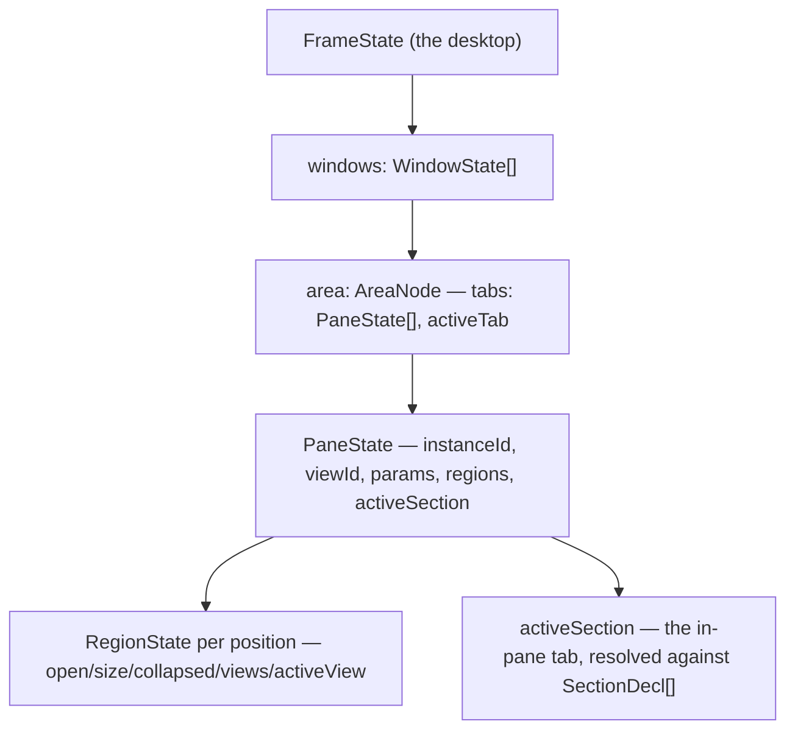

# Windowing: the desktop model

There is one desktop, and every pane on it lives in a **window**. A window can hold
several panes as **tabs**; inside a pane, **region strips** (the successor of panel
groups — see [panel-groups.mdx](panel-groups.mdx)) run down its own sides. That is
the whole model. How windows are _presented_ — the backdrop, the taskbar, snapping,
motion — belongs to [desktop-shell.mdx](desktop-shell.mdx); this page covers the
data they live in and the verbs that change it.

:::info History
Until 2026-10 a desktop could also be **tiling**: a Blender-style centre grid of
split areas, three tool docks with an activity rail per side, a workspace tab strip
across the top, and a dozen pre-arranged `frames:` presets (AI Research, Training,
Lab…). It was removed outright rather than hidden: two paradigms meant a lossy
convert between them, a mode menu to choose, and every feature built twice. Saved
layouts from that era are turned into windows on load — see
[Persistence](#persistence).
:::

## Decisions

- **Custom engine, no dockview.** A pure data layer plus a handful of React
  components. Modules never import the engine — the **module registry stays the
  public API**.
- **Two layers.** `packages/core/src/layout/` is the React-free source of truth:
  `types.ts` (data model), `model.ts` (pure window and tab ops), `store.ts` (one
  reducer store), `serialize.ts` (versioned schema) with `legacy-frame.ts` (the
  migration from tiling-era blobs), `controller.ts` (opening, window verbs, regions,
  the `LayoutController` seam), `persistence.ts` (autosave and hydration) — all
  unit-tested (`pnpm --filter @horrible/core test`). `packages/ui/src/desktop/`
  renders the window layer, the backdrops and the taskbar; `packages/ui/src/layout/`
  holds what a window draws inside itself (`PaneHost`, `Region`, `SectionTabs`), the
  native `TitleBar`, and `install.ts`, which installs the engine from the shell.
- **One desktop.** The layout is stored as the `desktop` workspace row. The backend
  still models a list of workspaces — it predates this — and rows other than
  `desktop` are left alone: nothing loads them and nothing deletes them.
- **Roles describe a pane; they do not place it.** Every view declares
  `role: 'document' | 'tool' | 'widget'`, and every one of them opens in a window.
  The role is how a view describes itself to the agent (`list_available_panes`) and
  to anything that groups panes:
  - a **document** is a surface you work _in_ — one per subject, several open at
    once, and it benefits from tabs;
  - a **tool** is a _companion_ to whatever you are working on — narrow,
    singleton, always the same thing;
  - a **widget** is a _readout_ — glanceable, sized to a tile, and the thing you
    would put on the `board` backdrop.

  Single-instance-ness is the `singleton` flag on a panel (widgets always are), not
  the role.

- **A narrow companion is a region strip.** Most of the obvious candidates
  (`editor.recentNotes`, `observability.logs`,
  `training.metrics`) already are regions of their host pane. A view that has become
  _purely_ a companion says so with **`embedded: true`**. See
  [Embedded views and sections](#embedded-views-and-sections).

## Model

- **WindowState** — one OS-style window. Its **content is an `AreaNode`**, a tab
  list: a plain window is an area with one tab, a merged window is an area with
  several, and the tab verbs (`SET_ACTIVE_TAB`, `REORDER_TAB`, `INSERT_PANE`) address
  a window by its area id. `findAreaAnywhere`/`updateAreaAnywhere`
  (`layout/model.ts`) resolve that id.

  Its **geometry is pixels**, measured against `FrameState.windowViewport` — the
  surface size the rects were last measured on. Fractions cannot express a minimum
  size, and would reflow a window's contents on every drag of the app's edge. On
  load, if the surface turns out to be a different size than when the layout was
  saved, every rect is rescaled proportionally through `SET_WINDOW_VIEWPORT` — which
  deliberately **does not bump `revision`**: it is a projection of the same layout
  onto a different surface, not a user edit, and marking it dirty would make every
  browser resize drive the 600 ms autosave debounce into a continuous write loop.

  `mode` is `normal | minimized | maximized`, and `snap` records the zone a window
  occupies. `snap` is **stored rather than re-derived** from the rect, because a
  window the user happened to drag to exactly half-width is not snapped and must
  not spring back to a restore rect when nudged. A minimized window keeps its pane
  **mounted** — see [Pane lifetime](#pane-lifetime-unmount-is-not-close).

- **PaneState** — one live pane instance (`${viewId}#${n}`); carries its params,
  its **persisted per-instance region strips**, and its **`activeSection`** (see
  [Embedded views and sections](#embedded-views-and-sections)).
- **windowViewport** — the surface size `windows[].rect` was last measured
  against, or `null` before anything measured it. A migrated v1 layout arrives as
  `{w:1,h:1}` so its old fractions become pixels through the ordinary rescale path,
  with no migration-only arithmetic to get wrong.
- **paneSeq** — one monotonic counter for pane instances, windows (`w<n>`) and their
  areas (`a<n>`), so a dispatcher holding a snapshot can precompute the ids an
  action will mint: `OPEN_WINDOW` takes the pane at `paneSeq` and the window and
  area at the two after it.

### Embedded views and sections

Two declarations exist to make **one pane hold what used to be several**, without
either half of the merge going wrong: the retired surface must stop being a
destination, and it must not stop being reachable.

**`embedded: true`** (on `PanelDecl` / `WidgetDecl`) says a view exists only inside
another pane. It stays fully registered — regions and sections keep working — but it
drops out of every affordance that would present it as a competing home:

| Surface                  | Effect                                                   |
| ------------------------ | -------------------------------------------------------- |
| `pane.open:<id>` command | not synthesized (`registry.ts`)                          |
| the Start menu           | filtered                                                 |
| `list_available_panes`   | no top-level row — listed under its host instead         |

The last row is the one that matters for the agent, and it is why `show` learned to
resolve an embedded view to _where it lives_: `show("Outline")` reveals it in its
host's region strip or section rather than failing to open it standalone. An
embedded view that **nothing hosts** is a declaration error, and fails loudly
(`ok: false`, and `openPane` returns null with a warning) rather than quietly opening
a window the flag said shouldn't exist.

`openPane` / `registry.openPanel` make the same resolution: opening an embedded id
reveals it in its host's strip or section (`hostOfEmbedded`) instead of opening it
bare in a window. A button labelled "Radar" and the agent's `show("Radar")` must land
in the same place — and the pane consolidation turned many former windows
(hAssault's companions, karaoke's queue, arXiv, the Python reference) into embedded
views, so every existing `openPanel('<old id>')` keeps working unchanged.

**`sections?: SectionDecl[]`** are in-pane tabs — the sibling of a region strip. A
region is a _companion_ beside the main content; a section _replaces_ it. Each
section declares an `id`, a `label` (what `show("friends")` matches), an optional
pick `key`, and its body as either an inline `component` or the `view` id of a
registered (usually embedded) view.

The host owns everything a module used to hand-roll:

- **`PaneState.activeSection`**, persisted **per instance** — the module singletons
  this replaces (games' `hub-section`, the client drawer) forgot the user's choice
  on every reload, and two panes of one view shared one value.
- `SectionTabs` (packages/ui), rendered by `PaneHost` above the body.
- A synthesized `section.show:<host>:<section>` command per section, plus a
  host-scoped keybinding for any declared `key`. Regions and sections share **one
  per-host letter space** — they share a keyboard scope, so a duplicate letter is
  dropped with a warning rather than left to resolve arbitrarily.
- `activeSectionOf` **resolves** rather than reads: a stored section id can outlive
  the declaration that named it (a saved layout loads against today's code), so it
  falls back to the default instead of rendering a strip with nothing selected.

A module picks its style: a section with its own `component`/`view` is rendered by
the host, and one with neither falls through to the host's own component, which
switches internally via `usePaneSection()`. Both exist because a pane being merged
usually already switches internally, and a new one usually doesn't want to.

Three options extend this, all introduced by the
[interpretability suite](../modules/interp-suite.mdx):

- **`sectionsLayout: 'rail'`** draws the sections as a vertical rail down the left
  edge (`SectionRail`), grouped under `SectionDecl.group` headings with vector icons
  named by `SectionDecl.glyph` — for a pane with more sections than a top strip
  holds.
- **`sectionsKeepAlive: true`** keeps a section mounted after its first visit,
  hiding it rather than unmounting it. Because a hidden section's verbs stay bound,
  the keymap has a **`paneSection`** context key; a single-key binding into such a
  pane names its section as well as the pane.
- **`SectionScopeContext`** lets a host answer `usePaneSection()` for a body one
  level down, so a pane that switched its own sections can become a section of
  another pane unchanged, its own tabs now a sub-strip. A rename in `RENAMED_VIEWS`
  may name a section (`{ to, section }`), so a merged pane's saved layout reopens on
  the right tab.

**The agent-context rule.** Unlike a region strip — which gets a synthetic instance
id (`${host}:${position}:${viewId}`) that neither `listPanes` nor `visiblePanes`
descends into — a section body renders inside its host's `PaneInstanceContext`, so
its provider registers under the **real, enumerable** pane instance id. Providers
are therefore keyed by **instance _and_ section**: `PaneHost` supplies the section
id through `SectionInstanceContext` around a body it renders itself, and
`useAgentContext` takes it from there (a pane that switches sections internally
passes it explicitly instead — its own registration is pane-level, and stamping the
host with the active section would put it and its inner bodies back on one key).

Keying on the instance alone was a silent-overwrite bug: whichever provider mounted
last won, its unmount restored nothing, and the workaround was a standing rule that
a pane may have only one. Now a pane-level snapshot and the mounted section's
**merge**, section last, and reads are pinned to the _active_ section so a provider
that outlives its switch cannot answer for the tab that replaced it.

The active section **and the list of siblings** are stamped onto every snapshot
centrally by `readPaneAgentContext`, not left to each module — a merged pane's
snapshot is ambiguous without the first, and a module that forgot would produce a
plausible-looking snapshot the agent then reasons about wrongly. The sibling list is
there because many sections still have no provider at all (only the _mounted_ body
can provide): a bare `{section}` gave the model nothing to answer from, and a pane
that returns nothing does not produce "I don't know" — it produces a confident
answer sourced from whatever else was in the context window. `hasPayload: false`
now names that case explicitly.

**Contributed sections.** Sections are declared by the pane that owns them, which is
right when the tabs are the pane's own — and wrong for [Explorer](../modules/explorer.mdx),
whose entire purpose is to be the one place you go to find _something_, wherever it
lives. A view opts in with `explorerHost: true`, and any module (or plugin) adds a
tab through `ModuleManifest.explorerSources`. `ExplorerSourceDecl` **is** a
`SectionDecl`, so nothing downstream is a second mechanism.

**Shell indicators.** Some state must stay on screen when no pane shows it — the
canonical case is [share](../modules/share.mdx#knowing-you-are-live)'s "your screen
is being broadcast". A module declares `ModuleManifest.shellIndicators`
(`{id, component}`), and `packages/ui/src/layout/ShellIndicators.tsx` renders every one
in the taskbar `Tray` and, on the native shell, in the `TitleBar` too. The **module**
decides visibility: each component renders `null` when it has nothing to say, and the
slot is `display: contents`, so an empty one adds no gap. Keep them rare; the tray's
own rule applies — a strip that grows one icon per module is a strip nobody reads.

The merge happens in the `registry.panels` / `registry.widgets` getters — at **read
time, not registration** — so module order cannot matter; the host may register
before or after its contributors. Merged decls are memoized against a registration
counter, because those getters run on every render path and a fresh object per call
would defeat `useSyncExternalStore` snapshots and every memo keyed on the decl.

### The minibuffer

Emacs's minibuffer and echo area. State and command matching live in
`core/src/minibuffer.ts` (pure, unit-tested); the strip is
`packages/ui/src/layout/Minibuffer.tsx`. Three states, in priority order:

| State      | When                            | What it shows                                         |
| ---------- | ------------------------------- | ----------------------------------------------------- |
| **prompt** | a `dialogs.prompt()` is pending | the prompt inline — label, prefilled input, OK/Cancel |
| **input**  | `alt+x` (M-x)                   | slash-command entry with live completions             |
| **status** | idle                            | `workspace › focused pane`, plus the echo area        |

**Slash commands** resolve against the same `registry.commands` the palette uses,
so nothing is registered twice. A command opts into a short name with
`slash: 'save'` (runs as `/save`); the leading slash is optional, so `/save` and
`save` are the same query. Anything without a `slash` stays reachable by fuzzy
title/id search. Ranking is exact-slash → slash-prefix → exact verb → verb-prefix
→ id substring → title substring, ties broken by registration order — which is
what makes **first-registered-wins** the rule for two commands claiming one slash
name. Current names: `/save`, `/save-as`, `/save-all`, `/new`, `/find`.

**Prompts render here, not in a modal.** `dialogs.prompt()` already existed and is
what editor Save As calls, so serving it in the minibuffer gave "save as, right
here" with no new API and every existing caller for free. `<Dialogs />`
deliberately skips `kind === 'prompt'` — rendering it in both places would show
two competing inputs for one pending promise. `confirm`/`choice` stay modal: a
destructive Save / Don't Save / Cancel should interrupt, not be a line you can
ignore.

The `alt+x` binding is declared `override: true` so a focused editor pane can't
shadow it — the minibuffer is the escape hatch and has to be reachable anywhere.

The shell mounts it as `<Minibuffer variant="overlay" />`, which floats above the
taskbar and renders nothing in the **status** state, because the taskbar's `mx` zone
is the desktop's status line. (It once wasn't mounted on a floating desktop at all:
`alt+x` flipped a store nothing rendered, and every prompt waited forever on an
answer the user was never shown.) See
[desktop-shell.mdx](desktop-shell.mdx#the-mx-zone-and-where-the-minibuffer-went).

### Where a window opens

A window opens **where that view's window was last left** — its rect, and the snap
zone if it had one (`core/layout/window-placement.ts`). Only when a view has no
memory does it fall back to the diagonal cascade.

The placement cannot live in the layout blob: a closed pane has no `WindowState` to
hold one, and "reopen the agent where I snapped it" is precisely a question asked
after it was closed. So it rides the settings store under `frame.windowPlacement`,
**globally and keyed by view id**. Keying by pane instance would be useless:
instance ids are minted per open, so the key could never be looked up again.

Two details are load-bearing:

- **The snap zone is stored alongside the rect, not derived from it.** A snapped
  window keeps a `restoreRect` to un-snap back to and re-derives its geometry when
  the desktop resizes. Replaying only the pixels produces a window that looks
  identical until either of those matters — and it re-snaps to the right half of
  _today's_ desktop rather than to stale pixels from a differently sized one.
- **Only single-pane windows are recorded.** A window holding three merged tabs has
  one rect and three views; filing that rect under each would teach every pane in
  the group a placement that belonged to the group.

Recording is a **store subscriber**, not a hook in the reducer or the drag handler.
A window takes its geometry from six places (drag, resize, snap, un-snap, maximize,
an agent tool), and remembering from each means the seventh silently does not;
reading the result catches them all by construction.

View types vs pane instances work as before: widgets are singleton-by-view-id,
panels honor their `singleton` flag, and multi-instance panes get `#n` suffixes.
A caller-supplied `instanceId` (e.g. `editor.buffer:<source>`) focuses the
existing instance instead of duplicating.

### Tabs

A window's titlebar is its tab strip once it holds more than one pane. Dragging one
window's titlebar onto another's merges it in as a tab (`MERGE_INTO_WINDOW`); a tab
torn out lands in a window of its own (`WINDOW_FROM_PANE`, `tearOffPane`, the
`window.tearOff` command). Middle-click closes a tab, guarded, so a dirty buffer can
still prompt.

`REORDER_TAB` carries `activeTab` **by identity, not by index**. Every naive reorder
bug is the same one: the user drags a background tab past the active one and the
window silently switches to a different pane. Rearranging the strip must not change
what is on screen.

### Opening a pane that is already open

`openPane(viewId, {params})` on a pane that is already open **applies the params,
then focuses it**. It used to focus and return, dropping them.

The failure was invisible and inverted: a deep link — "compare these six runs",
"score this checkpoint", "show me the turn behind this eval case" — worked only
while its target pane happened to be *closed*, and did nothing when it was open.
Open is the normal state for a pane you are working in. Nothing threw and nothing
warned; the pane came to the front showing what it showed before, which reads as the
button being broken.

`RETARGET_PANE` cannot serve here — it refuses `instanceId === newInstanceId` by
design, and a singleton's instance id *is* its view id, so there is no new identity
to move to. Hence `SET_PANE_PARAMS`, applied where `openPane` focuses an existing
pane.

Params are applied **only when supplied**. A plain "open the LocalTrack pane" from
the palette passes none and must not wipe a selection a deep link (or the user)
established — absent means "no opinion", not "clear it". Pinned by
`controller.test.ts`.

## The controller: one set of verbs, three callers

All mutations are dispatches into the layout store, exposed two ways from
`core/layout/controller.ts`:

- the **`LayoutController` seam** (`registry.setLayoutController`) for the
  engine-agnostic basics (close, focus, list, tear off, `changePaneType`), and
- **plain controller exports** for everything else — `openPane`, `openDocument`,
  `retargetPane`, `tearOffPane`, the window verbs (`snapWindow`, `snapFocused`,
  `setWindowMode`, `focusWindow`, `cycleWindows`, `focusWindowDirection`,
  `arrangeDesktop`, `minimizePane`, `activateTaskbarEntry`), `presentPane`, the region
  verbs (`toggleRegion`, `setRegionView`, `revealRegionView`), `setPaneSection`,
  `revealSection`, and `showTarget`.

**`openPane(viewId, opts)`** opens a view in a window of its own, or focuses it.
Identity: a caller-supplied `instanceId` is focus-or-create; a singleton (every
widget, and any panel that says so) is found by view id, so a second open focuses
the first rather than adding a twin; anything else opens a fresh window each time —
a second terminal is a second shell. A new window opens where that view was last
left ([Where a window opens](#where-a-window-opens)).

`showTarget(target)` is the **intent** verb sitting above all of them: it takes loose
text (a pane title, a view id, a **section** label, a region label), resolves it with
`layout/show.ts` (pure, unit-tested), then open-or-focuses, switches to the named
section or reveals the region — returning the resulting pane's agent-context
snapshot. It exists so the agent can reach a surface in one call instead of
`list_available_panes` → `open_pane` → `get_pane_context`; see
[agent-tools](agent-tools.mdx#show-the-intent-verb). `VIEW_ALIASES` beside it keeps
retired pane names resolving forever, which is deliberately a different lifetime from
`serialize.ts`'s `RENAMED_VIEWS` (that one repairs saved layouts; this one preserves
the agent's vocabulary).

`retargetPane(instanceId, newInstanceId, params)` is the **reuse** counterpart to
`openPane`: it re-points an already-open pane at a new identity in place, keeping its
window, tab position, viewId, and region strips, and refuses when the new id is
already taken (the caller then falls back to a normal focus-or-create open). It
exists so a caller that knows a pane holds nothing worth preserving can land in it
rather than accumulate placeholders — the editor uses it so opening a note from a
**blank, unmodified** buffer reuses that editor instead of opening a second one. See
[editor](../modules/editor.mdx).

`openDocument(viewId, instanceId, params, canReuse?)` packages that rule as the
one way a module opens "a thing" (a notebook, a project, a URL) in a
**non-singleton** document pane. It resolves in three steps:

1. **Already open** — a pane with that `instanceId` exists → focus it. This is
   why the `instanceId` must be derived from the thing's identity
   (`notebook.editor:<path>`), not left to the `#n` counter: without it, opening
   the same notebook twice yields two panes.
2. **Reusable pane open** — a pane of the same view that isn't dirty
   (`setPaneDirty` / `isPaneDirty`) and that the caller's `canReuse` accepts →
   `retargetPane` into it, so the window, tab position and region strips survive.
   Only the module can judge reuse, so the predicate is its call; a module whose
   panes autosave (notebook, training notebook, browser) passes `() => true`,
   meaning "any clean pane of mine".
3. **Otherwise** — a normal `openPane`.

Omitting `canReuse` opts out of step 2 and gives identity-only behavior. A pane
that genuinely wants one instance per invocation (a terminal) uses neither and
calls `openPanel` directly.

Such an opener should also pass a **`title` param** naming the thing it opened.
A view's declared title names a *kind* of pane, so without it every open notebook
is a window and a taskbar button reading "Notebook Editor". `paneDisplayTitle(pane)`
(`layout/controller.ts`) is the one rule — `title` → `name` → `path` → the view's
declared title — and the window titlebar, its tabs and the taskbar all resolve
through it, so a pane is never labelled two different ways at once.

The **user's gestures**, the **keybinding commands**, and the **agent's layout
tools** (`show`, `open_window`, `window_state`, `arrange_windows`, `toggle_region`,
`get_layout`, … relayed through `tool-exec.ts`) all converge on these same functions —
one code path, and every mutation rides the store's autosave. Layout verbs stay
**ungated**. See [agent-tools.mdx](agent-tools.mdx).

## Pane lifetime: unmount is not close

Only a window's **active tab** renders, so a pane unmounts constantly, for reasons
that have nothing to do with the user closing anything. A React cleanup cannot tell
those apart, and the panes that owned something expensive assumed the destructive
reading: `TerminalPane` killed its PTY on unmount, and the browser released the last
reference to the shared Chromium engine. **Looking at another tab for four seconds
destroyed your shell** — and handed back a fresh one that looked identical, which is
why it read as "state was lost" rather than as a bug.

`layout/pane-lifetime.ts` is where that distinction lives. A resource created
through `paneSession` survives every unmount and is disposed only on a real close:
`closePaneGuarded` and `changePaneType` (the outgoing view's resource). Nothing is
timer-based. The pattern is
not new — notebook and training kernels are already process-global for exactly this
reason ("closing a pane leaves the kernel running; reopening reattaches") — this
generalizes it to the frontend.

Two details are load-bearing:

- **Keys are scoped by workspace row** — `(workspaceId, instanceId)` — because
  `paneSeq` lives on `FrameState`, so instance ids are unique only _within_ a frame.
  There is one desktop now, but the key still says which layout a resource belongs
  to.
- **The terminal keeps its DOM element**, not just its session. Moving the xterm host
  between mounts preserves the rendered scrollback exactly; rebuilding the terminal
  around a surviving PTY would not.

**Minimizing must not unmount either.** A minimized window is moved off screen with
a transform, not `display: none` and not by rendering different JSX: an early return
with a different tree makes React reconcile the body to a different position and
rebuild the subtree, which is exactly this failure with a new trigger. `display:none`
is also wrong here for a second reason — it collapses a canvas or an xterm to zero
size, and many of them never recover their measurement when shown again.

If a close path is ever missed the resource leaks until the page closes, where the
backend reaps it anyway (PTYs die with their `/ws` connection). That is deliberately
the failure we chose: strictly better than killing a live shell on every tab switch.

### View state: the cheap half

Beside the resources sits `paneUiBag` — the same keys, a separate map, and the same
close/move/reset paths, holding what a pane was *looking at*: scroll offset, caret
position, which markdown cell was open for editing. Nobody loses work when one of
these is dropped, which is why they are not sessions. But a notebook that jumps back
to the top and an editor whose caret resets to zero every time you glance at another
tab are indistinguishable, to the person using them, from having lost their place —
and the fix is small enough that it should not be reinvented per pane.

`use-pane-ui-state.ts` is the React side: `usePaneUiState(key, initial)` is shaped
like `useState` so there is no way to update a value and forget to remember it, and
`usePaneScroll()` returns a ref for a scroll container. Two details are easy to get
backwards:

- **Restore in an effect, not on state init.** The element has no scrollable content
  until its children have laid out; an earlier write is clamped to 0 and the pane
  still jumps to the top.
- **Save on scroll, not in a cleanup.** A tab switch tears the subtree down, and a
  cleanup that reads `scrollTop` can find the element already detached — where it
  reads 0, which is exactly the value that looks like success.

A second, separate cache lives in `BufferView` for the same reason, keyed by **source
URI** rather than by pane: reopening a file anywhere should land where you left it,
not only in the pane you left it in. It records caret and scroll on `view.destroy()`,
before the teardown detaches `scrollDOM`, and restores only when no
**code locus** claimed the buffer first — a locus is someone *asking* for a line, and
restoring over it would silently undo a go-to-definition.

None of this is written to the layout blob. `serialize.ts` carries what the user
arranged; a scroll offset is where they happened to be looking, and persisting it
would dirty the layout — and drive the 600ms autosave — on every wheel tick.

## Persistence

The store holds `{ workspaceId, frame }` as **one atom**; the debounced (~600ms)
autosave reads both from the same snapshot at fire time, so it can never write a
layout under the wrong id — this retired the old engine's race-guard refs.

### Losing an edit: the four ways, and why none of them are open

A layout edit is invisible until it is written, and a window that is still on screen
looks saved whether or not it is. Every one of these presented as "refreshing reset
my desktop", so each is closed deliberately rather than by luck:

- **A save that fails is retried.** `lastSavedRevision` advances only _after_ the PUT
  resolves. It used to advance before, so a failed write — the backend restarting
  under `--reload`, a dropped connection — left the store believing it was clean and
  no retry was ever attempted. The frame is a full snapshot, so the retry needs no
  record of what was lost: one later success carries every edit since.
- **Saves never overlap.** Each serializes the frame before awaiting, so a slow save
  of revision 5 landing after a fast save of revision 6 would write the older layout
  last. They are strictly sequential, and a request arriving mid-flight waits rather
  than skipping (skipping would report an unsent edit as saved).
- **The last edit before a refresh is flushed.** `pagehide` / tab-hidden writes the
  pending frame with a `keepalive` PUT — a normal `fetch` started during unload is
  cancelled with the document, which made the 600ms debounce a window in which every
  edit was lost. `sendBeacon` is the obvious tool and the wrong one: it can only POST.
- **A boot that cannot read the layout never overwrites it.** `hydrate` retries the
  read (boot races the backend: the desktop shell spawns it alongside the UI, `pnpm dev`
  restarts it on every save), and on real failure the store stays **un-hydrated** —
  which is what keeps autosave switched off, so the blank frame on screen can never be
  written over the layout still safely on disk. The shell then says so and offers a
  reload, because an empty desktop with no message is indistinguishable from one that
  was erased.

Layouts serialize as a **versioned envelope**
`{ schema: 'horrible.frame', version: 3, frame }` to `PUT /api/workspaces/desktop`;
the backend (`backend/modules/workspace/`) stores each `layout` **opaquely**.
`deserialize` validates defensively, prunes panes whose views no longer exist (e.g.
an uninstalled plugin), renames views that were merged away (`RENAMED_VIEWS`), and
returns `null` for anything that isn't a frame blob — a pre-frame legacy layout is
discarded by design and the desktop starts empty.

**v2 → v3** removed the tiling frame. A v2 blob still carries `center` (the split
tree) and `docks`, and on a floating desktop those held panes too — the grid was
retained, just not drawn. `legacy-frame.ts` turns them into windows rather than
dropping them:

- a **tiling** desktop's grid becomes one window per non-empty area, at the pixel
  rect that area occupied, so the first load after the upgrade looks like the last
  one before it; a visible dock's active tool becomes a window at the dock's
  geometry, and every other docked tool a **minimized** window — mounted, one click
  away, not on screen, which is what a tool behind a rail glyph was;
- a **floating** desktop's grid and docks were never on screen, and the taskbar
  already called those panes minimized, so they stay minimized.

The migrated windows stack beneath the ones the blob already had, ids are minted past
everything in it, and nothing is clamped there: on a v1 blob the basis is the unit
square, where the pixel helpers in `snap.ts` would produce nonsense.
`SET_WINDOW_VIEWPORT` clamps every rect once it knows the real size.

**v1 → v2** was the desktop shell's own migration. `floating[]` became `windows[]`,
and the old fractional rects are carried over by setting `windowViewport` to
`{w:1,h:1}` so they scale into pixels through the **ordinary rescale path** rather
than through migration-only arithmetic that only ever runs once and is therefore
never exercised again. A v1 blob takes both steps in one load.

The backdrop is the one thing that deliberately does **not** come back as it was: a
v1 desktop had no backdrop, because there was no surface one could show on. Choosing
`none` would look conservative and would in fact hand every upgrading user a blank
landing screen for a feature they never turned off, so a migrated desktop gets
`DEFAULT_BACKDROP`.

The version guard rejects a blob whose version is **higher** than this build's, so
an older build reading a v3 blob starts empty — **downgrading discards the layout
rather than corrupting it**. That is the intended trade: a v2 build would find no
`center` and could only show its own empty grid.

## Browser vs desktop

The engine is web-only and shared verbatim by the browser and the desktop shell
(no per-platform fork). The window layer and pane presentation are in-window; the
native shell claims the OS-level versions through capabilities, all via the
`WindowControl` seam: **`window.fullscreen`** — on desktop `F11`
(`shell.toggleFullscreen`) toggles native OS-window fullscreen, orthogonal to
presenting a pane in-window (`area.fullscreen`); and **`chrome.workspaceTabs`** — the
desktop window is undecorated and the app draws its titlebar (`TitleBar.tsx`: drag,
double-click maximize, min/maximize/close controls, and edge-resize grips for the
borderless frame). The capability keeps the name of the workspace tab strip that
used to be that titlebar. (`window.perWorkspace` — a workspace in its own OS window —
went with the workspaces.) See the capability table in
[layout-shell.mdx](layout-shell.mdx).

**External links.** The app page never opens windows of its own — the shell refuses
`window.open` and `target="_blank"` (a new window would inherit the shell bridge) and
sends http(s) ones to the system browser — and it exposes an **`open_external`**
command (`apps/desktop/src/window.ts`, http/https only) that hands a URL to the
user's default browser via `shell.openExternal`. The shared helper
`openExternal(url)` (`packages/core/src/external.ts`) branches on the runtime:
browser layout → `window.open`, desktop → the command. The desktop boot also
installs a document-level **external-link bridge** (`installExternalLinkBridge`,
capture-phase click handler) so every plain `<a href="https://…">` in the app
routes to the system browser without per-component work. OAuth flows (games
sign-in, connectors) call `openExternal` directly — the system browser carries the
user's existing sessions, and Google refuses OAuth inside embedded webviews
(RFC 8252). Distinct from `browser_open_url`, which deliberately opens an
app-owned browser window as the embedded browser's un-iframable-site escape hatch.

:::danger A command the shell does not know is refused at runtime
The shell answers only the names in its `COMMANDS` table (`apps/desktop/src/main.ts`);
anything else rejects — no build error, no type error, and nothing in the UI unless
the caller checks. Under the Tauri shell the same failure had a second cause (an ACL
permission missing beside the registration), and `open_external` shipped that way:
`openExternal` caught the rejection and returned `false`, the link bridge discarded
that `false`, and OAuth sign-in and _every external link in the desktop app_ silently
did nothing. `scripts/desktop-smoke.mjs` now drives the commands in the packaged app.
See [Onboarding](../modules/onboarding.mdx#the-bug-that-motivated-all-of-it).
:::

**Both mechanisms fail quietly**, so `openExternal` returns whether it actually
opened and callers that need the user to _arrive_ somewhere must check it. The
bridge reports failure through `onExternalOpenFailed`, which `AppShell` turns into
a persistent toast carrying the URL — necessary because the bridge cancels the
browser's own navigation before substituting its own, so a failed substitute means
the click is simply gone.

## Dev affordance

In dev builds the shell exposes `window.__horribleFrame = { store, registry,
exec }` — `exec(name, args)` runs any relayed layout tool exactly as the agent
would (`await __horribleFrame.exec('get_layout', {})`). Not set in production.

## Status

Implemented: the window model (windows with tabs, merge and tear-off, snapping,
minimize/maximize, presentation), engine-native **persisted regions** and sections,
remembered window placement, the minibuffer, the versioned serialization schema with
its migrations from v1 and from the tiling frame, the agent layout tools, and the
native shell's two capabilities (`window.fullscreen`, `chrome.workspaceTabs`). Not
yet: region view cycling on repeat-press.
