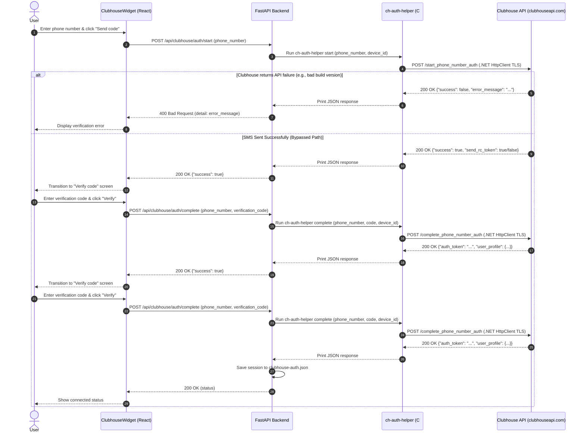
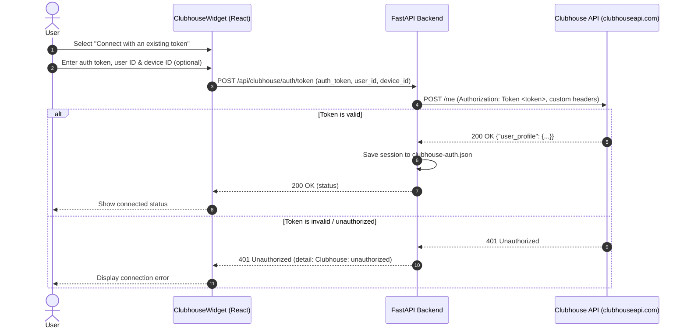

# Module: clubhouse

Clubdeck-style onboarding for a Clubhouse account. The widget offers three ways
in, chosen from a switcher at the top of the card:

- **Text me a code** — phone number → we ask Clubhouse to send the SMS → verification code → connected profile.
- **I have a code** — enter a phone number _and_ a code you already hold, skipping our `/auth/start` call entirely. Use this when you requested the code from the real Clubhouse app, or when the anti-abuse gate swallowed our SMS request: `/complete_phone_number_auth` carries no server-side state from the start call, so a code obtained anywhere completes the same way.
- **Auth token** — connect directly with an existing `auth_token` + `user_id`.

Above those, when the backend runs on the same machine as **Clubdeck** and Clubdeck is signed in, a **“Clubdeck detected”** banner offers one-click **Import** — no code, no paste. It reads the session Clubdeck already holds (see the Clubdeck note under §3) and connects with it. `GET /auth/clubdeck` reports availability (present + whose, or one of three unavailable reasons — not installed / signed out / unreadable) so the banner only appears when it will work; `POST /auth/import-clubdeck` performs the link, sharing the token-connect path. Since it reads a file off local disk it is inherently same-machine only (the browser can't), and it never returns the token to the frontend.

**Status: implemented** — frontend in [ClubhouseWidget.tsx](file:///home/horrible/horrible-dashboard/packages/core/src/modules/clubhouse/ClubhouseWidget.tsx),
backend in [routes.py](file:///home/horrible/horrible-dashboard/backend/modules/clubhouse/routes.py). Token-connect is verified end to end
against the live API; phone-auth depends on Clubhouse's gate (see below).

## Unofficial API & The Verification Gate

Clubhouse has no public API. Like Clubdeck, the backend speaks the
reverse-engineered mobile client protocol (`www.clubhouseapi.com/api`,
overridable via `HORRIBLE_CLUBHOUSE_API`), sending mobile-client headers and a
`CH-DeviceId`. That device id is the **connected session's own** — the device the
token was issued to — on _every_ call, unauthenticated ones and the auth helper
included (`_device_id`), falling back to a stable per-install id only when nothing
is connected. A real client never changes device mid-session; Clubdeck sends the
`deviceId` saved beside its token.

### 1. Client-Version Headers

Clubhouse validates two version headers — `CH-AppVersion` (`26.09.16`) and the **numeric** `CH-AppBuild` (`1038456`, also the `User-Agent`). A stale pair earns "Please upgrade your app" on room actions and makes SMS codes come back `is_verified: false`. Update both constants in [routes.py](file:///C:/Users/Horrible/Code/horrible-dashboard/backend/modules/clubhouse/routes.py) `_headers` **and** `auth_helper/Program.cs`, then delete the compiled helper so it rebuilds.

**Where to read the pair.** `aapt dump badging <apk>` gives `versionName` and `versionCode`, and those are the two values — established rather than assumed: run it on the 26.08.30 APK and it returns exactly `versionCode='1038152' versionName='26.08.30'`, the pair that had been read out of `defpackage/cb1.java` by hand. Cross-check in the dex before trusting a new one: the build literal should occupy the same slots the old one did (for 26.08.30 → 26.09.16, `classes3.dex` ×2 and `classes4.dex` ×1, in the dex that also holds `CH-AppBuild`), and the superseded build should appear nowhere.

**`check_for_update` does not confirm a bump** — measured 2026-09-20, it answers `{"success": true, "has_update": false}` for the *stale* pair as readily as the current one, so it discriminates nothing. Neither does poking a gated route from outside a room: `/audience_reply` answers `Invalid channel ID` for both pairs, because the channel check runs first. **The gate is only observable from inside a room**, which is also the only place it does any harm.

### 2. The attestation gate — why SMS sign-in no longer works

`start_phone_number_auth` in the 26.08.30 client attaches a `tokens` → **`AttestationRequest`** (`rc_token` reCAPTCHA, `integrity_response` Play Integrity, plus the legacy `safety_net_*`). Clubhouse now **rejects a code request that carries none**, answering `{"success": false, "error_message": "login did not pass token validation!"}`.

These tokens can only be minted by the signed Clubhouse app running on a Google-Play-certified device. **No TLS fingerprint or header trick from a desktop helper can produce one**, so the `ch-auth-helper` WinHTTP bypass (which defeated an earlier, softer Cloudflare/JA3 gate) no longer gets an SMS dispatched. `/auth/start` detects this message and steers the user to token-connect rather than surfacing the raw error. That depends on `_run_helper` handing Clubhouse's reply back: the helper exits 1 on **every** non-2xx and wraps the reply as `{"error": "Clubhouse returned status 400: {…}"}`, and raising on the exit code alone once hid the steer behind a generic "Authentication failed" (a test with a mocked `_run_helper` could not see it — `test_start_auth_attestation_gate_survives_the_real_helper_exit` fakes the subprocess instead).

The C# helper still exists and still sends the current version headers; the WinHTTP-vs-`HttpClientHandler` platform split remains (Windows uses the trust-listed WinHTTP stack, other OSes fall back). But this is now moot for `start`: attestation gates every platform equally.

### 3. Token-Connect — the working path

`POST /auth/token` (the **"Auth token"** tab) takes an `auth_token` + `user_id` captured from a real logged-in Clubhouse session and validates them against **`/get_profile`** (of the account's own id) — deliberately **not** `/me`, see the route-block note below. It needs no attestation and is the supported way to link an account. Capture the token from the official app's traffic (or a prior successful sign-in); it is stored server-side only.

**From Clubdeck (verified 2026-09-14).** Clubdeck still gets an SMS dispatched where the helper is refused. After signing in there, `%APPDATA%\Clubdeck\profile.json` holds `token`, `userId` and `deviceId` — pass **all three**. The session is issued to that device, so `/auth/token` records it and also **adopts it as the install id** (`_adopt_device_id`), so a later sign-in from this machine presents the same device rather than a new one. Without a `device_id`, the install id is recorded explicitly. The session is shared with Clubdeck: signing out there likely ends it here too. Clubdeck's API calls ignore `HTTP_PROXY` and `--proxy-server`, so a proxy capture of its login records nothing.

### The `/me` + `/get_feed_v3` route block (Cloudflare 503)

Cloudflare intermittently serves a **503 "Application temporarily unavailable"** on **exactly two routes — `/me` and `/get_feed_v3`** — while every *other* authenticated route (`/get_profile`, `/get_settings`, `/get_activities`, `/get_followers`, …) answers normally from the same machine, same IP, same token. Verified 2026-09-12: those two 503 while the rest return a clean `401` on a bad token; the official app on the *same Wi-Fi* uses them fine. It is **not** the IP, the token, TLS/JA3, HTTP version, headers, or the `__cf_bm` cookie — all were tested and ruled out. It is a **per-route rate/abuse rule**, and it is easy to trip by polling: a reconnect loop hitting `/me`, or `channels()` paging `/get_feed_v3` six times a refresh, is exactly the traffic that provokes it. It decays once that traffic stops. Two consequences the code now respects: **token-connect validates via `/get_profile`, not `/me`**, so linking an account works while `/me` is blocked; and a 503 on these routes is surfaced as a clean "temporarily unavailable" (see `_raise_for_upstream`), never as a token or payload error. The **room list still depends on `/get_feed_v3`**, so browsing live rooms is the one thing that waits for the block to clear — a room joined by known id does not.

### 4. Headers & Endpoints Reference

To communicate with Clubhouse, the backend passes specific metadata headers to authenticate and pass validation checks. If Clubhouse updates its mobile apps and starts rejecting requests, these headers and build versions must be updated in the backend config:

- **Base API URL:** `https://www.clubhouseapi.com/api`
- **Common Request Headers:**
  - `CH-Languages`: `en-US`
  - `CH-Locale`: `en_US`
  - `CH-AppBuild`: `1038456` (numeric build)
  - `CH-AppVersion`: `26.09.16` (app version)
  - `CH-DeviceId`: the connected session's `device_id`; otherwise the per-install uppercase UUID in `.data/clubhouse-device-id` (which token-connect overwrites with the device it was given).
  - `User-Agent`: `clubhouse/android/1038456`
- **Authenticated Request Headers:**
  - `Authorization`: `Token <auth_token>`
  - `CH-UserID`: The numeric user ID linked to the session.

#### Reversed Endpoints Reference:

- **POST `/get_feed_v3`:** Fetches the active hallway rooms list. (Replaces the deprecated `/get_channels` endpoint which returns a Cloudflare/Clubhouse `404 Not Found`). It returns a list of feed items; the backend filters for entries containing a `channel` dictionary to extract room lists.
- **GET `/get_cofollows`:** Returns profiles of followed users. Replaces `/get_following`, which was removed from the API (it 404s and the 26.08.30 client does not reference it). Note it is a **GET with query params**, not a POST body.
- **GET `/get_activities`:** Recent activity, replacing the removed `/get_notifications`. It paginates by **opaque cursor** (`next_cursor`), so the page/page_size the old route took has no meaning and was dropped rather than ignored.
- **GET `/get_handraise_queue`** / **POST `/update_handraise_queue_setting`:** the hand-raise queue, replacing the removed `/update_is_ask_to_join_allowed`. The queue read is **moderator-only**: a listener in the same room gets a bare `400 Invalid request.`, relayed as a 403. Raising a hand is still **`/audience_reply`** (`channel`, `raise_hands`, `unraise_hands`), which is alive in 26.08.30 and verified live — it is not a retired route.
- **POST `/set_chat_permission`** (`chat_permission`: 1 open / 2 host's followers / 3 trusted followers — the values a room serves in its own `chat_permission_options`), **POST `/emoji_reaction`** (`channel` + `emoji`), **POST `/get_channel_audience`**, **GET `/search_channel_users`**, **POST `/mute_other_speakers`**, **GET `/get_mutual_cofollows`**, and **POST `/get_profile`** with `username` in place of `user_id`.
- **POST `/me`:** Used to validate an existing token and fetch the corresponding user profile.
- **POST `/start_phone_number_auth`:** Starts phone authentication (handled by the native `ch-auth-helper`).
- **POST `/complete_phone_number_auth`:** Verifies verification code (handled by the native `ch-auth-helper`).

#### Removed features (2026-09-02)

These called routes that are **404** upstream and have no successor in the
26.08.30 client, so the panes, API functions and models for them were deleted
rather than left to fail:

- **Clubs** — `get_club`, `get_club_members`, `follow_club`, `unfollow_club`.
  Gone product-wide; `get_house*` 404s too, so there is no renamed successor to
  point at. The `Club` model survives only because the **feed** still carries a
  `social_club` badge on a room — that is display data, not the clubs API.
- **Events** — `get_events`, `edit_event`, `delete_event`.
- **Online friends** — `get_online_friends`.
- **Room visibility** — `make_channel_public`, `make_channel_social`.
- **Skin tone** — `update_skintone`.

`accept_speaker_invite` was **not** deleted: it migrated to `become_speaker`,
which does still exist. Don't re-add anything above without probing it first —
a 404 route reads as a working feature right up until someone uses it.

#### Endpoint status (probed 2026-09-02, against the 26.08.30 route table)

Unauthenticated probes discriminate cleanly, because Clubhouse answers three
different ways — and the difference decides whether a fix is even possible:

| Response | Meaning |
| --- | --- |
| `401` + JSON + an `Allow:` header | route exists; only auth is missing (the `Allow` header also confirms GET vs POST) |
| `404` + HTML | route removed from the API |
| `503` + Cloudflare HTML | never reaches the app; **no client-side change gets past it** |

On 2026-09-02 a 503 blanket covered the whole live-room path (`me`, `get_feed_v3`,
`join_channel`, `send_channel_message`, …). **It has since lifted** — every one of
those answers authenticated requests again (verified 2026-09-08 and 2026-09-10) —
so a failure there today is our payload or the room, and the status code still
says which.

#### Request rules (probed live against a real account, 2026-09-10)

Read out of the 26.08.30 serializers and then confirmed on the wire:

- **Every room read needs membership.** `get_channel`, `get_channel_audience`,
  `get_channel_messages` and `search_channel_users` all answer a 400 for a room
  the account is not in — `get_channel` with `should_leave: true`, the rest with
  an empty `error_message` — and 200 for the identical request once joined.
  `audience_reply` is the odd one out: it answers **200 for a room you have
  left**, so a hand "raised" there succeeds and does nothing. `_raise_for_upstream` turns `should_leave` into
  a **409 "not in this room"**. The pane used to fetch the chat backlog *before*
  `join_channel`, which made it a guaranteed 400 on every join.
- **`source` is an int code**, the client's `SourceLocation` enum (`PROFILE=4`,
  `CHANNEL=5`, `SEARCH=9`, `HALLWAY=14`) — the code, not the name and not the
  ordinal. `/follow` refused our string `"feed"` with *"A valid integer is
  required."*, so following someone never worked.
- **`create_channel`** takes `privacy_level` ∈ `public` / `friend` /
  `friend_of_friend` / `house` (the last needs a `social_club_id`); `private` and
  `social` are refused as *not a valid choice*. It has **no `topic` field** — the
  room is titled afterwards with `set_channel_title`, which can refuse in the
  room's first moment (*"Invalid operation"*), so it is best-effort. And it must
  send **`is_chat_enabled: true`**, or the room starts with
  `can_post_to_chat: false` *for its own host*.
- **`cannot send message` has two causes**: not being in the room, and the room
  refusing this account chat (`user_capabilities.can_post_to_chat: false`).
- **`get_channel_messages`**'s default page is the *latest* messages, newest
  first; the backend reverses it to match the pane's append order.
  `is_chronological_order=true` pages from the start of the room instead.
- `active_ping` answers `should_leave: true` once the room ends or a moderator
  removes you; the pane now leaves on it.
- Gone or gated (not implemented): `get_room_recap` and `get_channel_shares` 404;
  `get_karma_details` answers *Not available*; paid reactions are behind a
  feature flag; `get_replays` needs a `social_club_id`; `search` needs
  `limit_to_object_types`.

Separately, `check_for_update` answers unauthenticated and is the cheapest check
that our version headers are current — it keys on the numeric **`CH-AppBuild`**,
not the dotted version. With the old pin (`26.07.07` in both headers) it answers
`has_update: true, is_mandatory: true`; with the 26.08.30 client's real values
(`CH-AppVersion: 26.08.30`, `CH-AppBuild: 1038152`, `User-Agent:
clubhouse/android/1038152`, read off `defpackage/cb1.java`) it answers
`has_update: false`. (An earlier version of this page called that response frozen
for every version — it only looked that way because the build header carried a
version string.)

**The version is enforced as of 2026-09-10.** A stale client gets "Please upgrade
your app" on room actions, and an SMS code comes back `success: true,
is_verified: false` with `number_of_attempts_remaining` that never goes down —
the code is not even checked. `/auth/complete` now reports that as "Clubhouse did
not accept that code (N attempts left)" rather than "wrong or expired code". This
is distinct from `login did not pass token validation` on `start`, which is the
anti-bot gate and is not fixed by a version bump.

> [!NOTE]
> **Token-Connect (The Backup Path):** While the C# helper bypasses standard bot gating, users can still use **Token-Connect** to link their accounts directly. Users can supply an existing `auth_token` and `user_id` (captured from an active official app session).

---

### The version gate is named, not relayed

Clubhouse gates features on the client version **per feature**, not at sign-in. So an
account connects, rooms open, chat works — and mute, hand-raise and join-stage all
stop together, which reads as a broken pane rather than one stale constant. Measured
in one day of a real session: `/mute_speaker` refused 161 times, `/become_speaker` 46,
`/audience_reply` 21.

Its own wording hides the cause. `/mute_speaker` answers **"Sorry, they need to update
their app before this feature will work on them!"** — on a self-mute, "they" is us,
and relayed verbatim it sends whoever reads it to look at the other user or at the UI.
`/audience_reply` says "We're rolling out new room changes! Please upgrade your app on
the App Store".

`_raise_for_upstream` recognises both phrasings (`_UPGRADE_GATE`) and answers with the
cause and the fix — bump `CH-AppVersion` and `CH-AppBuild` in `_headers` and in the
auth helper's `Program.cs`, read off a current APK — while keeping Clubhouse's own
sentence, which is how you recognise the gate again a year from now. The check runs on
every upstream error, so it is deliberately narrow: "Less is more! Please wait a bit",
"A moderator moved you to the audience" and "cannot send message" must pass through
untouched, and a test pins that.

### Why the agent stops hearing, and how the pane now says so

Two faults in the hearing path, both of which present as the same thing — the LIVE
STT card sitting on "Microphone listening for room audio…" forever.

**Joining a room where people are already talking wired up nobody.** The sweep after
`client.join()` tested `remoteUser.audioTrack`, which is only populated by
`client.subscribe()` — so straight after a join it is `undefined` for every user and
the loop connected nothing, ever. It read like a safety net while being a no-op,
leaving the agent's hearing wholly dependent on `user-published` firing afterwards.
That is exactly the difference between joining an empty room (someone publishes
later, the event fires, it works) and **switching** into a room mid-conversation. The
sweep now subscribes, plays and connects, per-user so one failure does not cost the
rest — and tracks are deduplicated by id, because `user-published` reaches the same
speaker and a track summed twice inflates both the level and the count.

**The panel could not tell three different situations apart.** "Listening…" meant the
room is quiet, *or* no audio ever reached the agent, *or* the level never crosses the
threshold — three different fixes behind one sentence. `EarsReadout` replaces it with
what is actually known, polled at 4 Hz (the VAD writes its level 50×/s; pushing that
through React would re-render the pane at 50 Hz):

- the **VAD's own decision variable** on a meter, with the speech threshold drawn on
  it as a line, so "loud enough for me but not for the switch" is visible;
- **tracks wired in** — zero with people plainly talking is a different bug from a
  level that never crosses;
- **capture tap state** (`tap live` / `down`), **context state**, and the watchdog's **restart count**;
- how long since words were last transcribed.

The thresholds (`SPEECH_LEVEL`, `BARGE_IN_LEVEL`) are named constants now rather than
inline numbers, because the meter draws the same line the VAD decides on and the two
must not drift.

### A failed join must fail visibly

The symptom was **clicking Join Room and nothing happening**: `join_channel`
returned 200 with its tokens, then the pane sent nothing more (no `active_ping`, no
chat backlog) and sat on "Connecting…" with no error. Two causes, both fixed:

- **The error handler waited on itself.** `joinRoom` runs inside
  `session.serialize`, and its `catch` awaited `leaveRoom()`, which queues through the
  same `serialize` — i.e. behind the join that was waiting for it. Any failure after
  the Agora client existed therefore settled nothing, and every later join or leave in
  that pane queued behind it. The `catch` now calls `session.teardown()` directly
  (which also sends the upstream leave, since `activeChannel` is set once
  `join_channel` succeeds), and sets `error` **after** teardown, because teardown
  resets the state.
- **Agora steps are bounded.** `client.join` (20s), `client.publish` (10s) and
  `audioCtx.resume()` (2s, non-fatal — a strict autoplay policy leaves it pending
  rather than rejecting) go through `within()`. Agora retries a failing gateway or ICE
  negotiation internally for minutes, so an unbounded await was indistinguishable
  from a slow room; the timeout turns it into a "Voice Error" naming the step.

### The network inspector opens from anywhere

The pane returns from **two places** — the room view (`if (joined && activeChannel)`)
and the lobby below it — and `MediaInsightsModal` was mounted only in the lobby's
tree, while both buttons that open it (📡 Network Insights in the room header, and
Inspect in the Agent panel) live in the room view. So in a room the click set the
flag, the button lit up as active, and nothing rendered: the state was true in a
branch with no modal in it. It is also the branch you actually want it in, since that
is where there is a peer connection to inspect.

The element is now built **once** (`networkModal`) above the branch and rendered in
both trees, so the two mounts cannot drift, and the openers **toggle** rather than
latch — a control that renders an "on" state has to be able to go off.

A third opener was added to the **lobby header**, deliberately outside the
`state === 'ready'` gate that its neighbours sit behind. That gate was there at first
and the pane disproved it within a minute: when Clubhouse's edge returned its
intermittent 503 on the room feed, the lobby rendered the error with only Refresh
beside it and the inspector vanished — in the one state it exists to explain. A
diagnostic available only when nothing is wrong is not a diagnostic. With no room
joined it reports `DISCONNECTED / IDLE`, `Channel: None`, which is a real answer and
the one you want when a join is what failed.

The **Agent panel's Inspect row** had the same shape of fault one level down: the
"📡 Protocols & Media Telemetry" card sat deep inside `{agentEnabled && (…)}`, so with
the voice agent paused — the state the panel opens in — the row did not exist and the
button was simply not on the page. Nothing about UDP, PubNub or Agora depends on
whether the agent is running, so it is hoisted out of both agent branches.

Three source-level guards pin all of it (`networkModal-mounts.test.ts`): the element
is built once, it is mounted in both trees, and neither opener sits behind an
unrelated gate. They are asserted against the file rather than a render because this
pane is ~5000 lines behind a live Clubhouse session, an Agora client and a PubNub
socket — mounting it in jsdom would test the mocks, while what broke here was purely
*where an element sits between two returns*. Each guard was checked by reintroducing
the bug and watching it fail.

### A mute the room never heard about

`toggleMute` sets a local gain and *then* tells Clubhouse, and the second half used to
fail into `console.error`. Both halves matter and they fail differently: the gain is
ours and always takes effect, so your microphone really is gated either way — what
breaks is the **badge the rest of the room sees**, which is why the message says that
rather than "mute failed". Swallowed, this was 161 silent failures presenting as a
button that does nothing.

### Badge-letter names (the blue spaced capitals)

Some names show on phones as bold, blue, widely spaced capitals. Clubhouse has no
name-style feature: the profile payload carries no style, and the 26.09.16 APK has no
font or colour key for names. The name is spelled in **regional indicator symbols**
(U+1F1E6–U+1F1FF, the code points flag emoji are built from), with a **zero-width
space between letters**. Without that separator adjacent letters pair into flags (P+R
is Puerto Rico, I+N is India). A lone indicator has no flag to become, so the phone's
emoji font draws it as a letter, and Samsung's draws a blue capital.

[`badgeLetters.ts`](https://github.com/ConstCorrectness/horrible-dashboard/blob/main/packages/core/src/modules/clubhouse/badgeLetters.ts)
encodes and decodes these names. It pairs indicators the way a phone does: an unfenced
pair stays a real flag (🇮🇳 is a flag, not "IN"), and only an unpaired indicator is a
letter. Desktop emoji fonts draw lone indicators inconsistently (Segoe UI Emoji shows
small grey caps), so `<ClubhouseName>` decodes each run to ASCII and styles it itself
in the accent blue. Every place the pane shows a name goes through it, along with
`firstName` and `nameInitials`. Tiles show the first word, split on real whitespace
only. A zero-width separator is not a word break, so a badge name keeps all its
letters. Initials come from the decoded name, so they never show half an emoji.

**Edit name** on your own profile card (`POST /me/name` → Clubhouse `/update_name`)
opens an editor with a live preview. **Badge letters** converts the selected letters
(or the whole name when nothing is selected), adding a separator against any badge
letter already at either edge, so "Horrible PROBIN" can keep its first word plain.
**Plain** converts the letters back. Clubhouse may limit how often a name can change.
Its refusal is shown as a toast.

## Authentication Flow Diagrams

### SMS Phone Authentication Flow

This diagram illustrates the phone verification flow, highlighting how the C# auth helper subprocess matches a trusted TLS signature to bypass Clubhouse's reCAPTCHA gate.



### Token Connection Flow

This diagram shows how users connect an existing session token (bypass path).



---

## Backend API Endpoints

All routes are prefixed by `/api/clubhouse` and documented via Pydantic models in [models.py](file:///home/horrible/horrible-dashboard/backend/modules/clubhouse/models.py).

### 1. `GET /status`

Checks if the local dashboard is connected to a Clubhouse account.

- **Response Schema:** [ClubhouseStatus](file:///home/horrible/horrible-dashboard/backend/modules/clubhouse/models.py#L32)
- **Response Body:**
  ```json
  {
    "connected": true,
    "user_id": 4242,
    "username": "horrible",
    "name": "Horrible User",
    "photo_url": "https://example.com/photo.jpg"
  }
  ```
  _(Never exposes the stored `auth_token` to the browser.)_

### 2. `POST /auth/start`

Initiates the SMS verification process.

- **Request Schema:** [StartAuthRequest](file:///home/horrible/horrible-dashboard/backend/modules/clubhouse/models.py#L10) (`phone_number`: E.164 string format `+15551234567`)
- **Response Schema:** [StartAuthResult](file:///home/horrible/horrible-dashboard/backend/modules/clubhouse/models.py#L28)
- **Errors:**
  - **400 Bad Request:** Thrown if Detections match `send_rc_token: true` or `success: false` (displays a clean warning explaining the verification gate/reCAPTCHA blocker).

### 3. `POST /auth/complete`

Submits the texted code to complete authentication and retrieve the auth token.

- **Request Schema:** [CompleteAuthRequest](file:///home/horrible/horrible-dashboard/backend/modules/clubhouse/models.py#L14) (`phone_number`, `verification_code` — 4–8 digits; Clubhouse currently sends 6)
- **Response Schema:** [ClubhouseStatus](file:///home/horrible/horrible-dashboard/backend/modules/clubhouse/models.py#L32)
- **Behavior:** Stores session details (including the `auth_token` and optional `refresh_token`) inside `$HORRIBLE_DATA_DIR/clubhouse-auth.json`.
- **No dependency on `/auth/start`:** neither this route nor `ch-auth-helper` keeps state between the two calls, so the widget's "I have a code" path posts here on its own with a code the user obtained elsewhere.

### 4. `POST /auth/token`

Directly connects an existing session token bypass.

- **Request Schema:** [TokenConnectRequest](file:///home/horrible/horrible-dashboard/backend/modules/clubhouse/models.py#L19) (`auth_token`, `user_id`, `device_id` optional)
- **Response Schema:** [ClubhouseStatus](file:///home/horrible/horrible-dashboard/backend/modules/clubhouse/models.py#L32)
- **Behavior:** Validates the token against Clubhouse `/get_profile` for the account's own id (not `/me`, which Cloudflare intermittently blocks), then persists the session.

### 5. `DELETE /auth`

Signs out: leaves the room this node joined, then deletes the stored credentials.

- **Order matters:** `/leave_channel` needs the token this deletes, so the backend leaves the room it last joined (and has not left) _first_, with the token still valid. Done the other way round, the leave is refused as "not connected" and Clubhouse keeps listing the account in the room until its missed `active_ping`s time it out. A failed leave is logged and never blocks the sign-out; the room's voice-agent memory is dropped either way.
- **The frontend leaves first too:** `disconnectClubhouse()` calls `leaveClubhouse()` (from `presence.ts`) before the `DELETE`, because only the browser can close the Agora and PubNub connections. The widget's Disconnect button and the agent's `clubhouse.disconnect` tool both go through it.
- **No upstream logout:** Clubhouse's API has no logout route, and the stored token is usually Clubdeck's own session (see Import from Clubdeck), which revoking would end as well. Sign-out only forgets the session on this node.
- **Response Schema:** [ClubhouseStatus](file:///home/horrible/horrible-dashboard/backend/modules/clubhouse/models.py#L32) (resets connected to `False`)

### 6. `GET /channels`

Returns currently live Clubhouse channels.

- **Response Schema:** [ChannelList](file:///home/horrible/horrible-dashboard/backend/modules/clubhouse/models.py#L67)
- **Errors:** **409 Conflict** if not connected.

### 7. `GET /following`

Returns profiles of people followed by the connected account.

- **Response Schema:** [FollowingList](file:///home/horrible/horrible-dashboard/backend/modules/clubhouse/models.py#L78)
- **Errors:** **409 Conflict** if not connected.

### 8. `POST /channels/{channel}/join`

Joins a live Clubhouse room and retrieves voice / signaling tokens.

- **Response Schema:** [JoinChannelResult](file:///home/horrible/horrible-dashboard/backend/modules/clubhouse/models.py#L82)
- **Body Parameters:** None.
- **Errors:** **409 Conflict** if not connected.

### 9. `POST /channels/{channel}/leave`

Leaves a live room.

- **Response Schema:** Generic success object.
- **Body Parameters:** None.
- **Errors:** **409 Conflict** if not connected.

### 10. `POST /channels/{channel}/ping`

Keeps the room voice session active (heartbeat ping). Should be called every 30 seconds while connected to a channel.

- **Response Schema:** `{ success, should_leave }`. `should_leave: true` means the
  account is out of the room — it ended, or a moderator removed you — and the
  pane leaves on it (unless it has already switched to another room). Before, it
  kept showing the room while every send was refused.
- **Body Parameters:** None.
- **Errors:** **409 Conflict** if not connected.

### 11. `POST /channels/{channel}/mute`

Notifies Clubhouse of speaker mute/unmute state. Relays to upstream
`/mute_speaker` — **not** `/update_is_muted`, which no longer exists and answers
404, so the mute button used to fail silently.

- **Request Schema:** `MuteRequest` (`is_muted` boolean)
- **Response Schema:** Generic success object.
- **Errors:** **409 Conflict** if not connected.
- **`user_id` is required upstream.** Sending only `channel` and `is_muted` gets
  a `400 User id is required.` — a rejection the pane swallowed, so the mute
  button once again did nothing. Mute here is always _self_-mute, so the id is
  the connected account's.

### 12. `POST /channels/{channel}/hand`

Raises or lowers a hand in the channel.

- **Request Schema:** `HandRequest` (`raise_hands` boolean)
- **Response Schema:** Generic success object.
- **Errors:** **409 Conflict** if not connected.

### 13. `POST /channels/{channel}/accept_speaker`

Comes up on stage after being invited to speak.

- **Request Schema:** none — takes only the channel in the path.
- **Response Schema:** Generic success object.
- **Errors:** **409 Conflict** if not connected.

> [!NOTE]
> Upstream is `/become_speaker`, not the removed `/accept_speaker_invite` (404).
> The 26.08.30 client pairs it with the `/reject_speaker_invite` we already call,
> and **neither carries a moderator id** — you accept the stage itself, not one
> particular person's invitation, so there is no user id to get stale.

### 14. Moderation & room control

These exist because a room you _host_ needs more than joining and muting. All
409 when not connected, and all return a generic success object.

| Route                                       | Request                                        | Upstream                                                   |
| ------------------------------------------- | ---------------------------------------------- | ---------------------------------------------------------- |
| `POST /channels/{channel}/invite_speaker`   | `InviteUserRequest`                            | `/invite_speaker` — promote an audience member              |
| `POST /channels/{channel}/topic`            | `UpdateTopicRequest`                           | `/set_channel_title`                                        |
| `POST /channels/{channel}/handraise_settings` | `HandraiseSettingsRequest`                   | `/update_handraise_queue_setting`                           |
| `GET /channels/{channel}/handraise_queue`   | —                                              | `/get_handraise_queue` — who has a hand up (GET-only, **moderators only**: 403 otherwise) |
| `POST /channels/{channel}/chat_settings`    | `ChatSettingsRequest`                          | `/enable_channel_messages` or `/disable_channel_messages`   |
| `POST /channels/{channel}/chat_permission`  | `ChatPermissionRequest` (`everyone` / `host_followers` / `trusted_followers`) | `/set_chat_permission` — named here, ints 1/2/3 only in `routes._CHAT_PERMISSION` |
| `POST /channels/{channel}/mute_others`      | —                                              | `/mute_other_speakers`                                      |
| `POST /channels/{channel}/reaction`         | `ReactionRequest` (`emoji`: any emoji or one line of text, ≤ 64 chars) | `/emoji_reaction` — the room lists its own emoji as `emoji_reaction_options` on join |
| `GET /channels/{channel}/audience`          | —                                              | `/get_channel_audience` — the room's listeners              |
| `GET /channels/{channel}/users/search?query=` | —                                            | `/search_channel_users` — find someone in the room          |
| `POST /send_channel_message`                | `SendChannelMessageRequest`                    | `/send_channel_message`                                     |

The join result also carries the room's own menus — `handraise_queue_setting`,
`handraise_queue_options` (value + label) and `emoji_reaction_options` — so the
pane can render what this room offers instead of a hardcoded list. They had to be
named on `JoinChannelResult`, or the response model drops them.

A room read for a room the account is not in (never joined, left, or ended)
answers **409 "not in this room"**, from Clubhouse's `should_leave: true`.

#### Reactions and GIFs in the pane

The reaction buttons render the room's own `emoji_reaction_options` (falling back to a
fixed six until the join result arrives) and send through `POST …/reaction`. They used
to float the emoji locally and publish an invented `react` message straight onto the
PubNub channel, which Clubhouse never saw — the sender watched their reaction rise and
nobody else in the room received it. The emoji now floats when the send **succeeds**
(Clubhouse echoes it back, and our own echo is skipped), and a refusal toasts.

The **+** button after them adds a custom reaction: any emoji or any short string,
saved in `localStorage` (`clubhouseCustomReactions`) and shown after the room's own
options. Right-click a custom one to remove it. Clubhouse draws whatever string it is
sent, so a text reaction floats across the room just as an emoji does. The backend's
`ReactionRequest` accepts any single line of up to 64 characters and refuses an empty
string, a longer one, and control, bidi-override or line-separator characters.
`normalizeCustomReaction` in `reactions.ts` applies the same rule, so the bar never
offers a reaction that would 422. The backend is not started with `--reload` under the
desktop app, so a validator change reaches it only after a restart. Until then a text
reaction answers 422 `emoji must not be empty` / `reaction must be an emoji`.

The add box also has a **style picker** for "fancy text": Plain, Bold, Italic, Bold
italic, Script, Bold script, Fraktur, Double struck, Sans bold, Monospace, Wide, Bubble
and Badge. The wire carries plain strings only, so a style is a different set of
characters, not formatting. `stylize` in
[fancyText.ts](file:///C:/Users/Horrible/Code/horrible-dashboard/packages/core/src/modules/clubhouse/fancyText.ts)
swaps letters for Unicode lookalikes. Most come from the Mathematical Alphanumeric
Symbols block; Wide uses fullwidth forms, Bubble uses circled letters, and Badge reuses
`toBadgeLetters` (the blue regional-indicator letters). You type plain text, and the
box shows a live preview and a code-point count against the 64 limit. **Send** sends it
once; **Add** puts it on the bar. The last style picked is remembered in `localStorage`
(`clubhouseCustomReactionStyle`).

- **Holes.** The math block leaves reserved code points where a letter already existed
  in Letterlike Symbols, such as italic `h` → `ℎ`, script `B` → `ℬ` and fraktur `C` →
  `ℭ`. A hole left unfilled renders as a box on every platform. Each style lists its
  holes, and a test fails if any style emits an unassigned (`\p{Cn}`) code point.
- **No stacking.** `stylize` folds already-styled text back to ASCII first
  (`unstylize`), so changing style re-spells the text instead of layering two styles.
- **Length.** Each fancy letter is one code point but two UTF-16 units, so the input
  has no `maxLength` (that counts units and would stop at about 32 letters). The
  counter and the Add/Send buttons go by code points, the unit the backend counts.
  Badge letters cost two code points each because of the zero-width-space fence.

Incoming reactions are read by `parseRoomReaction` in
[reactions.ts](file:///C:/Users/Horrible/Code/horrible-dashboard/packages/core/src/modules/clubhouse/reactions.ts),
which accepts an emoji under `react` / any `*reaction*` action, and an image URL under
any GIF-named action, and returns `null` — never a guess — for the rest.

The event as captured from a live room (2026-10-04) is
`{action: 'new_channel_reaction', action_user_profile: {…}, channel, message_id, message: ''}`.
Two things follow from it. **The sender is `action_user_profile`**, not `user_profile`, so
the hook reads that too — otherwise our own echo is not recognised and every reaction
floats twice. And **the field holding the emoji was hidden by DevTools' `{…}`**, so for a
`*reaction*` action the parser takes the first short string that is an emoji, never looking
inside the sender's block (its `photo_url` is on Clubhouse's CDN, which the GIF allowlist
permits — scanned, an avatar would render as a GIF). A message with no action only counts
through the explicit `emoji` / `reaction` field, so a chat line holding a link or an emoji is
not a reaction. The hook now logs each room message as `JSON.stringify` text, because a
pasted console loses a collapsed object's fields. Two guards:

- **GIFs render only from allow-listed hosts** (Giphy, Tenor, Clubhouse's own CDN),
  `https:` only, with no referrer. The sender chooses the URL, so rendering any address
  would give a stranger every viewer's IP and a picture they can swap at will. A GIF that
  is refused logs `Clubhouse GIF reaction not rendered:` with the raw message, which is
  how a missing provider host is found.
- **The overlay is capped at 30 floaters.** One animated node per message, each alive for
  three seconds, otherwise grows without limit when a reaction or GIF is spammed.

:::caution Sending a GIF is not built
Clubhouse sends a GIF through its own `/gif_reaction` endpoint (separate from chat), and
a room advertises support with `is_gif_enabled`. The request body, the GIF search source
and the exact PubNub message a GIF arrives as have not been captured (no GIF has appeared
in a capture yet), so the pane displays incoming GIFs on a best-effort reading but cannot
send one. The next capture containing a GIF pins it in `parseRoomReaction`.
:::

#### Posting to chat: spacing, retry, repeats

Two Clubhouse refusals showed up in a live room, and the agent's posts swallowed both:

- **`429 Less is more! Please wait a bit and try again`** — a rate limit. It fired between
  sends 3 s and 7 s apart, so the old fixed 300 ms between a long reply's chunks never
  cleared it, and a rejected message was simply lost.
- **`400 Looks like that's been said already!`** — an exact repeat. The old silence timer
  asked the model to "say something" every interval, a low-temperature model said the same
  48 characters each time, and the room got one refusal a minute, forever. (The timer is
  gone; `dedupe` still skips a line the room has already been told.)

Every post now goes through one `ChatSender`
([chatSender.ts](file:///C:/Users/Horrible/Code/horrible-dashboard/packages/core/src/modules/clubhouse/chatSender.ts)),
owned by the room session:

- **Serialized and spaced.** One chain for the agent and the person typing, with at least
  3 s between attempts — a rejected attempt counts toward the window too. The limit
  itself is not documented; 3 s is a measured-failure floor, not a known number.
- **A 429 is retried** after 5 s, then 10 s, and only then rejected with Clubhouse's own
  message (the composer toasts it). A 400, or anything else, is not retried.
- **The agent never repeats itself.** Its posts pass `dedupe`, so a line already posted to
  that room in the last 10 minutes is skipped instead of refused. A person's own message
  is never second-guessed: if they type it twice, Clubhouse decides and says so.
- **A repeated nudge says nothing.** If a nudge's reply equals the previous nudge's, the
  agent neither speaks nor posts it (`nothing new to say`) and waits a full extra interval
  before asking again.
- **Posting no longer holds up speech.** The reply is posted without being awaited, so a
  rate-limit wait cannot delay the audio; ordering is preserved by the sender's queue.
- **Leaving a room drops what is still queued** for it, rather than posting into a room
  you have left (or the next one).

### 15. `GET /channels/{channel}/chat`

The chat backlog, fetched on join so a late arrival sees what was already said —
live messages arrive over PubNub, which only carries what is sent after you
subscribe.

- **Response:** `{ "comments": [...], "next_cursor": ... }`, **oldest first**.
  Upstream's default page is the latest messages newest-first; it is reversed so
  the backlog reads like the live messages appended below it.
- **Fetched after the join, never before.** Like every room read it needs
  membership; the pane used to fetch it before `join_channel`, which was a 400 on
  every single join.
- **Degrades rather than fails:** chat can be disabled by a moderator, so an
  upstream error returns an **empty backlog**. A room with no chat is not a
  failed join.

### `cannot send message` usually means "you are not in that channel"

(The other cause is the room refusing this account chat —
`user_capabilities.can_post_to_chat: false` — which is also what a room created
without `is_chat_enabled: true` gives its own host. `create_channel` now sends it.)

Clubhouse rejects a chat write it does not like with a bare **`400 cannot send
message`** — no reason, no room named. Probed against the live API, the error is
specific: a **nonexistent** channel answers `Invalid channel ID`, while a real
room the account has **not joined** answers `cannot send message`. It is an
address error, not a permission or payload error — the same payload succeeds the
moment the account is actually in the room.

That made one ordering bug in `joinRoom` invisible for as long as it existed.
`joinClubhouseChannel()` moves the account into the new room — and out of any
previous one — the moment it returns, but `activeChannel` was patched at the
**end** of the join, after `AgoraRTC.createClient`, `client.join`,
`getUserMedia`, the track publish and the PubNub subscribe. A slow or failed step
anywhere in that stretch left the account in the new room while the pane still
addressed the old one, and every send went to a room it had left. The failure
surfaced as a generic "Failed to send message" toast, so it read as a broken
send rather than a wrong address.

The pane therefore claims the channel **as soon as the upstream join returns**,
which is the moment membership actually moves. `joined` is still set at the end,
because that gates the room UI on a working connection rather than on membership.
`joinOrder.test.ts` pins the ordering by reading the source — it is not reachable
from a unit test without standing up Agora and a microphone.

### Leaving a room must not close the audio context

The room's audio is built on `mixer.getContext()` — the app's one shared
`AudioContext`. The teardown used to `await audioCtx.close()` on it, which is not
a room teardown at all: it silences [every other module](audio.mdx) and, because
`getContext()` caches that context for the life of the page and never rebuilds a
closed one, it kills **the next Clubhouse join too**. The join's first
`createMediaStreamDestination()` throws `InvalidStateError`, the `suspended`
resume guard never fires (a closed context is `closed`), and the symptom the user
sees is a microphone that does nothing while the button reads *Mic Active*.

The teardown now disconnects the nodes it created (`humanGain`, the two
`MediaStreamDestination`s) and stops the physical mic stream, which drops its
source with it — the mixer's context is left running. The rule is enforced tree
wide by `modules/audio/__tests__/shared-context-is-never-closed.test.ts`.

The teardown also resets the room state in a **`finally`**. `leaveRoom` raises
`loading` before calling it, and every control in the room — mute, raise hand,
join stage, the chat composer — is `disabled={voiceLoading}`. A teardown that
threw or hung on one of its awaits therefore left the pane showing a room with
every button dead and no error to explain it.

### A missing microphone is reported, never mimed

`getUserMedia` is allowed to fail — a denied permission, no device, a webview
that does not grant capture — and continuing as a **listener** is a legitimate
outcome. What is not legitimate is doing it quietly. Without a microphone there
is no `humanGain`, so `toggleMute` used to change nothing, flip the label to
*Mic Active (Mute)* and tell Clubhouse the account was unmuted: the room shows a
live speaker and hears silence, which reads as a broken microphone rather than a
denied permission.

So the join's failure path raises a voice error naming the reason, and
`toggleMute` refuses outright when there is no microphone attached rather than
reporting a mute state it cannot honour.

### Chat availability is carried, not guessed

Chat is also decided per room and per account, and the join response says so — but
the response model was dropping the answer. `JoinChannelResult` now declares
`is_chat_enabled`, `is_room_chat_available`, `chat_permission`,
`chat_permission_options` and `user_capabilities`; the pane records the verdict as
`RoomState.chatDisabledReason` and **disables the composer with that reason in its
placeholder** instead of accepting text it cannot deliver.

`user_capabilities.can_post_to_chat` is the field Clubhouse computes for exactly
this question, and a room can have chat on while still refusing a given account,
so both are checked and they produce different reasons.

Two traps sit here:

- **The response model is the filter.** These fields reach the browser only
  because `JoinChannelResult` names them; a Pydantic response model silently
  drops what it does not declare, which is why the pane had no idea what the room
  allowed even though every join response said so.
- **Only an explicit `false` means off.** An absent flag is an older room, not a
  closed one — reading it as falsy would disable chat in every room that does not
  mention it.

Both the join verdict and a rejected send are logged by **value** — the send line
names the channel and message length, because a bare `cannot send message` in
`logs/backend.log` otherwise identifies neither the room nor the cause.

### Feed pagination

`GET /channels` walks up to **four pages** of `/get_feed_v3` rather than one,
deduplicating by channel id across pages. One page is a partial hallway, which
made the rooms list look like Clubhouse was empty.

A failure on the **first** page is raised, not swallowed. Returning an empty list
there renders as "no rooms are live", which is a different claim from "the feed is
unavailable" and a false one — the pane looked like a quiet Clubhouse while the
endpoint was in fact unreachable. Failures on **later** pages still break the loop
and keep what was already collected, since those pages are only ever extra.

---

## Voice agent

The room view can put an **LLM agent in the room**: it listens, decides when it
is its turn, and speaks. The speech pipeline is two routes on the agent module:

- **`POST /api/agent/stt`** — uploaded audio in, transcript out. Local Whisper
  (`whisper-tiny.en`). The pane sends **16 kHz mono PCM WAV**, which is read
  directly; any other container is decoded via `ffmpeg` as a plain subprocess on a
  worker thread (asyncio cannot spawn one under `uvicorn --reload` on Windows).
  Audio longer than Whisper's 30 s window is transcribed window by window — the
  processor otherwise truncates it without a word. Whisper answers silence with its priors rather than with nothing, so
  a small set of known hallucinations (`"you"`, `"thank you"`, …) is filtered to
  empty — otherwise the agent answers a room that said nothing. A `language` hint
  is forwarded to the transcriber (and on to a remote node's `/api/agent/stt`
  when the work is delegated); it is ignored by the English-only default model,
  which is why it is a hint rather than a setting.
  A transcription that **fails** answers `200` with an empty `text` **and an
  `error`** saying why, which the pane reports (deduplicated — the same message
  toasts once, however many requests hit it). It must not be an error _status_: the
  pane posts audio about once a second while anyone speaks, so a failure
  cannot be signalled the same way a room full of silence is. But it must not be
  indistinguishable from silence either, and it was — a node with a broken decoder
  (a corrupt upload, a model that would not load) ran an agent
  that sat in a room hearing nothing and never said why. That is the single most
  common report of the voice agent "not working".

- **`GET /api/agent/tts?text=`** — MP3 audio, via Edge TTS. `voice`, `rate`,
  `pitch` and `volume` are all passed through to the synthesizer, so the agent's
  loudness is tuned alongside its speed and pitch rather than left to the mixer.
  A synthesis failure is a **502** whose `detail` carries the cause, never an
  empty 200. A voice named `unsloth:<id>` is a **cloned voice** spoken by Unsloth
  Desktop instead, as WAV. See [Cloned voices (Unsloth)](#cloned-voices-unsloth).

Everything between those two — whether to answer, what the agent knows, what it
remembers — is the **voice session**, and it lives on the server.

### The conversation is a server-side session

`backend/modules/clubhouse/voice.py` holds one session **per channel**, process-global
(the [karaoke](./karaoke.mdx) precedent): a pane reload, a second pane, or a workspace
switch rejoins the same conversation instead of resetting it. `voice_runtime.py` is the
impure half — building the prompt and generating — so the policy in `voice.py` is
testable without a model, a network, or a connected account.

This replaced a one-shot `POST /api/agent/generate` issued from the pane with the raw
utterance as the entire prompt. That shape had three faults:

- **No memory.** Every utterance was an independent completion, so the agent could not
  follow a conversation or answer "what did you just say?".
- **No room knowledge.** It did not know the topic, who was on stage, who was
  moderating, or its own name — so "who's here?" was answered by invention.
- **No honesty about what it could not do.** `/agent search` built a prompt asking the
  model to "perform a simulated web search", which is a hallucination with extra steps.
  The agent now has no tools at all: it talks, and says so when it does not know.

### One generation per turn, and no tools

A live room is a realtime medium: every extra round against a local model is seconds
of silence while people talk. So a turn is **exactly one generation with no tools
offered**, and the **server** decides, deterministically, everything the model gets:

| Need | How it is met |
| --- | --- |
| Who is here, the topic, who is talking | `render_room_brief` — on the turn message every turn |
| Who these people are | bios fetched for **speakers only**, cached per session |
| What was said | the transcript, one `user` message per utterance |

The agent used to be offered music, look-up and room-moderation tools, remembered
people across rooms, and could be driven with `/agent play`, `/agent search`,
`/agent invite` and friends. All of it is gone: a room is strangers talking to your
agent, small models fumbled the tool calls, and every one was a way for the agent to
claim an action it had not taken. Two commands remain, `/agent forget` (clear what it
remembers) and `/agent help`; any other `/agent …` is reported as unknown rather than
answered in character.

### When it speaks

`should_respond` is a pure function, and every refusal carries a **reason** that the
pane renders and the debug log records. A silent agent and a broken one are otherwise
indistinguishable, which is the single most common "it doesn't respond" report.

There are three modes, each meaning one thing (the panel's **When it answers**):

- **`addressed`** (default, "When called by name") — only when its own name is said.
  Safest in a room of strangers.
- **`conversational`** ("Join the conversation") — also joins in on its own, but waits
  `cooldownS` between unprompted replies so two people talking cannot produce two
  overlapping answers. Being called by name always gets through the cooldown.
- **`always`** ("Reply to everything") — every line, **no cooldown**. (It used to
  share the conversational cooldown, so "reply to everything" still went quiet for six
  seconds after each reply.)

There are no wake words. `is_addressed` matches the agent's **own name** — the full
name or its first word ("Horrible" for "Horrible Program") — on word boundaries, so a
name of "Bo" does not fire inside "bottle". Because the utterance came through speech
recognition, which spells an unusual name differently each time, a first word of six or
more letters also matches **one edit away** ("horible", "horrable") when the first
letter agrees. A first word under three letters or a generic one (`the`, `dr`, `dj`, …)
is skipped: the fallback name "the agent" would otherwise fire on every "the". The cost
is a false positive when the name is also an ordinary word ("that's horrible").

The old `interject` mode, which cut into a speaker mid-sentence, is gone, along with
the partial-utterance path that fed it. A config that still says `interject` loads as
`conversational`.

The agent also never answers **its own voice**: its TTS is published into the room and
comes back through the same transcription path, so `is_own_speech` compares a
normalized word set with a similarity floor — an exact-match check would let every echo
through, and the result sounds exactly like a broken agent talking to itself.
Utterances shorter than three words are never treated as an echo, or one person saying
"yes" would be silenced.

Turn-taking (when an utterance ends) stays client-side in
[useClubhouseVoice.ts](file:///C:/Users/Horrible/Code/horrible-dashboard/packages/core/src/modules/clubhouse/useClubhouseVoice.ts):
a VAD watches the mixed stream and a pause closes the utterance, so the agent waits for
the speaker to stop instead of interrupting. How long a pause counts is the panel's
**Wait after someone stops talking** (`endpointingDelayMs`, 0.4–1.5 s).

### Live transcription — PCM, not `MediaRecorder`

The ears used to be a `MediaRecorder` producing WebM, and that shape could not be live:
a WebM blob only decodes from its first byte, so nothing was transcribed until the
speaker paused for the endpointing delay — in a busy room, often never — and getting
text mid-sentence meant *stopping* the recorder, which lost the audio between one
recorder and the next.

[liveCapture.ts](file:///C:/Users/Horrible/Code/horrible-dashboard/packages/core/src/modules/clubhouse/liveCapture.ts)
taps the agent's input bus (`session.sttBus` — every remote speaker plus the operator's
mic) with an AudioWorklet (a `ScriptProcessorNode` where the worklet will not load),
downsamples to 16 kHz, and keeps the current utterance in an `UtteranceBuffer` with a
400 ms pre-roll so the first syllable is not clipped. Because the utterance so far is
always one array:

- **Live caption** — about once a second while someone speaks, a snapshot of the
  utterance so far is transcribed and shown as the dimmed **LIVE** line under the last
  few finished sentences (`state.liveCaption`). One request in flight at a time, so a
  slow model sets the pace rather than queueing. It is display only — never sent to
  the agent.
- **Final** — when the speaker stops, the whole utterance is transcribed once and
  handed to `onTranscribe`. Finals are chained on `session.sttFinals`, so the agent
  hears sentences in the order they were spoken.
- **Length caps** — past 15 s an utterance is cut at the next gap between words, and
  at 25 s wherever it is. Without them a room where nobody pauses reaches the agent
  late or not at all, and Whisper drops everything past 30 s.

Measured on CPU `whisper-tiny.en`: a caption costs 0.2–0.4 s and grows a word or two
per second; the final arrives ~0.4 s after the speaker stops. A cold model load is
~8 s, which is why the health check warms it (below).

### Barge-in

**Stop talking when someone starts** (`allowBargeIn`, on by default). The VAD is
watching the mixed stream, which carries the remote speakers *and* the local mic but
never the agent's own TTS, so any real voice in the room stops playback: the audio
source is stopped, the TTS fetch and any generation in flight are aborted, and the
pending queue is dropped. It stops at a **TTS chunk boundary**, so it cannot cut a word
in half. With the setting off the agent finishes its sentence even if someone talks
over it. The setting is honoured in both places that act on a barge-in — the audio
layer and the pane's handler — which used to disagree: the pane cut the agent off
regardless, so turning the setting off changed nothing.

### Utterances queue; they are not dropped

The pane holds a serialized queue. The old code returned early whenever the agent was
already speaking, so anything said while it talked or thought vanished — including the
answer to a question it had just been asked. The backlog is capped at six, because if
the model is slower than the room the oldest utterances are the least worth answering.

Utterances are offered to the backend even when the agent is disabled or staying quiet:
it wants to hear a conversation it is staying out of, or "what were we just talking
about?" has no answer.

### Replies are cleaned before they are spoken

`clean_reply` strips speaker prefixes (`Agent:`) and stage directions (`*laughs*`) —
small models emit both regardless of the prompt, and TTS reads them aloud — flattens
markdown, and truncates on a **sentence boundary**, since a reply cut mid-word sounds
like the connection dropped.

### A transient provider failure is retried once, and every failure is legible

A local model server drops a request while it swaps weights. LM Studio does it with a
500 whose body is **Express's HTML error page**, and with
`{"error": "Model is unloaded."}` — both observed mid-room, both fatal to the turn,
and the same turn sent again a moment later answered normally. So:

- `_is_transient` retries **once** after `RETRY_BACKOFF_S`, and only for a failure the
  server owns — a 5xx, a dropped connection. A 4xx is ours (a model that isn't loaded,
  a bad payload) and retrying it only doubles the wait before the pane can say so; the
  turn's own `asyncio.TimeoutError` is not retried either, because the room has moved
  on.
- `_plain_text` strips the HTML, and a page left holding nothing but the words a status
  line is made of ("Error Internal Server Error") yields `""` so the status code is
  reported instead. A JSON body the response refused to parse is mined for its `error`
  first — `error` is a **string** on some servers and an object on others, and reading
  `.get("message")` off the string threw, which is how "Model is unloaded." — the most
  actionable message this route gets — was reported as raw JSON source.

### It stops working, and nothing says so — the ears watchdog

Everything upstream of the agent is a live browser resource that can die quietly and
stay dead:

- a capture tap whose processor died, so frames stop arriving,
- an `AudioContext` the OS suspended (autoplay policy, a device change, a
  backgrounded tab, or Safari's `interrupted` during a phone call).

None of them raise anything a person can see, and nothing else rebuilds them. So the
50 ms VAD loop goes on ticking over an analyser full of zeros, the pane goes on saying
"listening", and the agent is deaf until the room is rejoined. That is what "it worked
for ten minutes and then stopped" is. (In the `MediaRecorder` era the dead thing was
the recorder; the rule carried over unchanged.)

`session.earsInterval` checks every **2 seconds** and rebuilds. A tap counts as dead
when the context is running and it has delivered no frames for 3 s — a healthy one
posts every ~40 ms, silence included. The decision is a pure function, `earsActions`
in `earsWatchdog.ts`, so it can be tested without a real `AudioContext` (jsdom has
none); its `recorderState` input is the tap's liveness:

- A suspended context and a dead tap are **independent** failures and both flags
  can come back true, because a device change causes both. Resuming without
  rebuilding leaves a tap that never fires again; rebuilding without resuming
  feeds it silence.
- A **paused** recorder state is left alone — nothing here pauses one, so that state
  belongs to something else and stopping it would race whatever set it.
- The watchdog is deliberately **not** folded into the VAD loop. That loop is one of
  the things being watched, and a watchdog that dies with its subject is decoration.

It warns on the **second** restart, not the first: one is routine (a device
change), and a toast for every one is a toast people learn to ignore
before the day it matters.

### `GET /voice/health` — whether a turn would work, without taking one

The room agent fails by going quiet, and the three legs of a turn are separate
processes that stop for unrelated reasons while looking identical from a chair. The
health route separates them, cheaply enough to poll — the pane does, every 20s while
a room is open with the agent on, and renders a single green `READY` pill or a red
one per broken leg with its fix in the tooltip.

- **ears** / **mouth** — the `voice` extra, reported separately because they fail
  differently once it is installed. The ears also report whether **the Whisper model
  actually loads**: an installed extra over a model whose load throws reported
  "speech-to-text ready" while every request failed. The first poll also **warms the
  model** in the background, so the ~8 s cold load does not land on the first thing
  anyone says. `ffmpeg` is no longer an ears requirement — the pane sends WAV.
- **model** — the configured provider's own catalog, one request to a usually-loopback
  server. It honours the **room's `model` override**, since reporting the
  orchestrator's model healthy while the room points at one the server lacks is a
  green light for a turn that cannot happen.

Every leg carries `certain`, and a leg whose probe could not run renders as
**unknown**, never as broken — the hardware module's three states, for the same
reason: telling a working node to reinstall what it already has is the failure that
rule exists to prevent.

What it deliberately cannot see: a model the server has merely **unloaded** is still
listed in the catalog, so it shows green. The turn's own `reason` stays the authority
on a failure that already happened; health says whether the next one has a chance.

It is deliberately not `/api/agent/status`, which probes every provider in the table
— far too much work for a timer, and it answers a question about the agent's
configuration rather than about this room's next sentence.

### The system message is the persona, then the speech rules

The speech rules are kept **separate from the persona**: the user edits the persona
and must not be able to delete the rules that keep a reply speakable. They used to
be separate *paragraphs of the same system message*, though, alongside the room
brief and everyone's profile bios — and that was wrong twice over.

A persona is short. A real one measured 163 characters, against roughly 3 kB of
rules, room state and biography sharing the same message; the user writes a persona
and hears a model that mostly ignores it, with nothing to point at. And a bio is
**not ours** — it is profile text written by a stranger in the room, so carrying it
in the highest-authority message meant anyone could put "ignore your persona" in
their Clubhouse profile and have it arrive with the standing of a rule we wrote.

So `render_turn_context` puts the room brief and the bios on the
**current turn**, with the bios explicitly labelled as information about people
rather than instructions to the model. There is still exactly one system message,
deliberately: strict Jinja chat templates reject a second one outright, so a tidier
"context" system message is not available here.

The **speech rules**, though, went back into the system message, after the persona
(`persona + "\n\n" + SPEECH_RULES`). For a while they rode the turn too, and on
gemma-4-e2b that failed in a way worth remembering: "How to speak here: – Two or three
sentences…" arriving in a `user` message reads as a list of instructions the user just
handed over, so the model answered it — "I understand the instructions for how I should
communicate in this setting" — instead of speaking. Every such reply was remembered,
and a history of assistant turns that all acknowledge the rules is a few-shot example;
the model kept producing them for unrelated chat lines. The rules are ours and static,
so the system message is where they belong; what stays on the turn is facts that change
per turn, or text we did not write.

Three pieces keep it from coming back:

- **The turn ends on a cue** (`REPLY_CUE`: write only what you say next; do not
  acknowledge these notes), because the last thing a small model reads decides what it
  writes.
- **`is_meta_reply` drops an acknowledgement** — it is neither spoken nor remembered,
  and the turn returns `reason: "dropped a reply that only acknowledged the prompt"`.
  It needs both an acknowledging opening ("I understand", "I will respond/keep/speak…")
  *and* a subject that is the prompt itself ("the instructions", "plain spoken prose",
  "text chat only"), so "I understand your point, Piper" survives.
- **Remembered acknowledgements are skipped** when history is replayed, so a room
  already poisoned by them recovers without `/agent forget`.
- **A `notice` is for the operator, never the room.** A failed turn returns
  `notice` ("Couldn't reach the model server: …", "The model took too long — the room
  has moved on."), and the pane shows it as a toast only. With **post to chat** on it
  used to be posted to the room too, which put the agent's own error into a public
  room under the user's name.

Riding the turn is also the more correct place on the merits. The room brief changes
every turn — who is on stage, who has a hand up, who is talking right now — and
pinning it ahead of a twelve-turn history described the room as it was twelve turns
ago.

Bios are **speakers only**. The audience is a count in the room brief: a listener
cannot say anything the agent has to answer, so their biography buys nothing and costs
a hundred-odd characters.

### Each room line is its own message, and chat has a real sender

History is replayed with **one `user` message per remembered utterance**
(`Ada: …`, `Grace (@grace) in chat: …`), the agent's own replies as `assistant`
messages, and the current turn (room brief, the line being answered) as a
final `user` message of its own. The transcript reaches the model as the conversation
it is, not as a block glued onto the turn.

An agent that mostly listens therefore sends several `user` messages in a row, which
templates enforcing strict user/assistant alternation (older Gemma, Mistral) reject.
That is handled at the point of failure: when a server refuses the shape
(`alternate`, `jinja`, `roles must …`), `generate_reply` resends the same
conversation through `fold_consecutive_roles` — each run joined into one message —
and remembers the `(endpoint, model)` so later turns fold up front instead of
paying a rejected round trip. A window that opens on the agent's own line carries it
as `(Earlier, you said: …)` inside the first user message, since an assistant
message straight after the system prompt is the other shape those templates refuse.

A chat turn carries the sender the pane actually saw: the display name and
`@username` (`chatSpeakerLabel`) as `speaker`, and the user id as `speaker_id`. It
used to be enqueued with no sender at all, so every chat line reached the model as
"Someone in chat", and the model — told to address people by name — picked a name
off the stage.

**Every utterance is its own `user` message**, which a few chat templates (older Gemma,
Mistral) reject as consecutive same-role messages. That is handled at the point of
failure: `generate_reply` resends the same conversation folded
(`fold_consecutive_roles`) and remembers the `(endpoint, model)` so later turns fold
up front. Models that accept the shape — gemma-4-e2b on LM Studio does — are never
degraded for the sake of those that do not.

### Switching rooms tears the old one down first

There is no Leave between two rooms: the pane goes straight through `joinRoom`. It
used to build the new connection **on top of the live one**, so everything belonging
to the room you left kept running — its Agora client (still subscribed, still
publishing your microphone into it), its PubNub subscription, its ping and volume
intervals, its `MediaRecorder`, and its VAD loop.

The VAD loop is the one that does real damage, and it is not obvious why. It reads
and writes `session.sttRecorder` and `session.sttChunk` — *session* fields, so after
a switch they are the **new** room's recorder and chunk. Meanwhile its analyser is
still wired to the old room's destination, which is now silent, so it takes the idle
branch: every ~1.5 s it sets `chunk.discard = true`, stops the recorder and starts
another. It was discarding the new room's audio, on a timer, forever. Nothing
reached Whisper, `lastHeardSpeech` never updated, and the pane sat on *"Microphone
listening for room audio…"* while people talked. Every further switch added another
ghost doing the same thing.

`joinRoom` now `await session.teardown()` first — **before** the upstream join,
because `joinClubhouseChannel` moves the account out of the old room as a side
effect, so tearing down afterwards would be leaving a room Clubhouse had already
moved us out of.

Both joins and leaves also go through `session.serialize`, a one-at-a-time queue.
Switching is teardown-then-build and both halves await, so clicking a second room
mid-switch used to run two builds concurrently: the second teardown ran while the
first was still installing its intervals, tore down nothing, and left exactly the
orphans the teardown exists to prevent. A rejected task does not wedge the queue —
a failed join that jammed it would leave the pane unable to enter any room at all.

### A room switch clears the pane's per-room state

`joinRoom` resets the *session* — `joined`, `comments`, `liveUsers`, `speakingVolumes`
— but `RoomsPanel` keeps per-room state of its own in React, and nothing was
resetting it. Switching rooms therefore carried the room you left into the room you
arrived in.

The visible one was the **LIVE STT** panel. It kept rendering the last thing said in
the previous room instead of falling back to *"Microphone listening for room
audio…"*, and that panel is the only evidence in the pane that the agent's ears
work: a stale line there reads as a live transcript, and a genuinely fresh room
reads as one nobody has spoken in yet. Exactly backwards, in both directions.

Two of the others are not cosmetic:

- A **queued utterance is addressed at drain time**, from `activeChannelRef.current`
  — not when it was enqueued. So anything still in the queue when you switched was
  answered *into the new room*: the agent replying to a stranger, about something
  nobody there had said. An in-flight generation landed the same way.
- `agentSentTextsRef` is the echo-dedup set and is keyed on **text alone**, with no
  channel. Left uncleared it suppresses a genuine line in the new room because the
  old room happened to say the same words.

One effect keyed on `activeChannel` now drops all of it — the queue, the dedup set,
any in-flight generation, a reply still being spoken, the STT line, the agent's
reason and remembered turns, and the chat draft (which would otherwise be sent to the
wrong room, the same wrong-address failure the `activeChannel` ordering fix removed
from the send path). `roomSwitchResets.test.ts` pins each entry by reading the source;
an effect's dependency list is not reachable without rendering the whole pane.

### A nudge is a direction, not speech

The pane's **Speak Now** button asks the agent to take the floor. It used to do it by
enqueuing an ordinary `voice` utterance, so the model received `A speaker said out
loud: Say something to the room — pick up the current conversation` and answered
*that*: it replied to a speaker who did not exist. (A "take a turn after silence"
timer used to do the same on a schedule, with an invented speaker called `Room
Atmosphere`; it fired while someone was mid-sentence and has been removed.)

There is now a third `Source`, **`nudge`**, and the last message is rendered
`Direction (nobody said this aloud; act on it): …` instead of `X said …`. Three
consequences follow from "nobody said it":

- it is **not remembered** — a nudge in the twelve-turn history is a phantom line the
  agent will later summarise back at the room, and it crowds out real speech;
- it carries **no speaker name**; the pane's `'A speaker'` fallback is skipped.

What it does *not* change is the gate. `should_respond` treats `nudge` exactly as
`voice`, including `respond_to_voice` — a room with voice replies switched off must
not be nudged into talking through a side door.

### The pane may carry its settings with the utterance

`POST .../voice/turn` accepts the pane's whole `config` alongside the text. The
session is still the authority — it simply adopts what arrives — but a `config`
pushed separately races the turn that should have used it, so an utterance
arriving between an edit and its `POST .../voice/config` was answered under the
*previous* persona. Sending the settings with the utterance makes that
unrepresentable. `model`, `temperature` and `max_tokens` reach the provider from
that same config, so a room's agent can run a different model from the
orchestrator's.

The turn is generated with **thinking switched off** (`providers.chat(think=False)`:
`reasoning_effort: "none"` on LM Studio, `think: false` on Ollama,
`chat_template_kwargs.enable_thinking: false` on llama-server / vLLM). Reasoning
tokens count against `max_tokens`, so a thinking model left at its default — Gemma 4
thinks by default — spent the entire ~160-token spoken-reply budget reasoning and
came back with `content: ""` and `finish_reason: "length"`. That used to surface as
`model returned nothing`, indistinguishable from an agent choosing silence. A model
that reasons regardless (R1 distills) now raises instead, and the pane shows a
`notice` telling you to pick a non-reasoning model or raise max tokens.

The request also takes an explicit **`is_self`**. The agent must not answer its
own speech coming back through the room, and the fallbacks for recognizing it —
matching the speaker id, or overlapping the text it just spoke — both fail on a
paraphrase or a shared account. The client knows which audio it originated, so it
says so; `is_self: false` is a positive assertion that a human spoke, and the
text-overlap check still runs underneath as a backstop.

### Routes

| Route | Purpose |
| --- | --- |
| `POST /api/clubhouse/voice/turn` | One utterance in, one decision out (`spoke` / `reason` / `reply` / `notice`). Optionally carries the pane's live `config` and an explicit `is_self` — see above |
| `POST /api/clubhouse/voice/config` | Replace a room's agent settings |
| `GET /api/clubhouse/voice/config` | Read them back |
| `GET /api/clubhouse/voice/state` | What the agent currently remembers, plus the last 60 debug-log events (rendered in the Agent panel) |
| `POST /api/clubhouse/voice/reset` | Forget the conversation, keep the settings |

A turn carries a **room snapshot** pushed by the pane rather than polled by the server:
the pane holds the PubNub feed and the Agora volume indicator, so it is seconds fresher
about who is muted, has a hand up, or is speaking right now.

### The debug log

Every decision is recorded twice. `VoiceSession.log` appends a `TurnEvent` to a bounded
per-room deque (200) **and** writes one line to `logs/backend.log`
(`voice[<channel>] skipped voice 'Chaya' (not addressed): '…'`; failures at WARNING,
with the traceback), so the story survives a pane reload and a crash alike. Kinds:

| Kind | Meaning |
| --- | --- |
| `skipped` | the gate said no — the `reason` is the gate's (`not addressed`, `cooldown (4s left)`, `own speech`, …) |
| `replied` | spoken; carries generation time, model and token usage when the provider reported them |
| `silent` | the model answered but the reply was dropped (`model returned nothing`, acknowledged the prompt) |
| `command` | `/agent forget`, `/agent help`, or a memory reset from the panel |
| `error` | generation failed or timed out; `detail` has the provider's own message |

`GET /voice/state` returns the newest 60. The pane merges them with its own events —
speech-recognition and playback errors, barge-ins, a failed settings sync — which only
it can see, and shows them newest-first in the panel's **Debug log** card, with
errors-only, Copy and Clear.

### The side panel

The panel is `AgentSidebar.tsx` (it was ~1,100 lines of inline JSX in `RoomsPanel.tsx`);
the room pane owns the voice session and passes it config, status and actions.

- **Collapsible**: sections are cards whose open/closed state is remembered, and the
  whole panel hides from its ✕ or the top-bar **Agent panel** button. Hidden, a thin
  rail stays on the edge with a dot for what the agent is doing (off, listening,
  thinking, speaking, or an error such as a failed health leg) and reopens it. Whether
  it is open, and its width, persist.
- **Settings**: persona (presets, save/delete your own, apply with or without clearing
  memory), when it answers, hearing, voice, model. Every control changes something the
  agent does in every mode.
- **Model for this room** is the per-room override only. It used to be paired with an
  "Active Engine Model" select that rewrote the *dashboard-wide* agent config.
- **Config hygiene**: every change goes through `normalizeVoiceConfig`, which clamps
  numbers, rejects wrongly typed values and migrates old saved configs (wake words,
  turn eagerness, thinking filler, silence timeout, interject posture and interval,
  and the look-up settings are dropped). Settings are pushed to the server debounced;
  a failure is shown in the panel and logged instead of only reaching the console.
- **Presets**: built-ins ship in code; only your own are stored (`agentPresets`). Saving
  uses the app's prompt dialog, not the browser's native `prompt()`.

A provider failure is **reported, never raised** — the route answers 200 with
`reason: "model error"` and the provider's own message ("Failed to load model X"). A 500
here is indistinguishable in the pane from an agent that chose not to answer, and the
model not being loaded is the most common cause of a room agent that has gone quiet.

The agent also takes a **per-room model override** (`model`, blank = the configured
agent model). A live room is a latency budget, not a reasoning budget: the orchestrator
may be on a 27B that takes twenty seconds a turn, which is unusable when people are
talking.

### The reply starts speaking before it has finished synthesizing

`playAgentAudio` used to `await res.arrayBuffer()` for the whole utterance and then
decode it, so nothing played until every sentence had been synthesized **and**
transferred. That cost is paid in full no matter how fast the synthesizer is.

The reply is now split by
[speechChunks.ts](file:///C:/Users/Horrible/Code/horrible-dashboard/packages/core/src/modules/clubhouse/speechChunks.ts)
and each chunk is fetched **one ahead** of the one playing, so the listener waits only
for the first and every later synthesis hides behind the audio already running. The
first chunk is deliberately the smallest — it is the only latency anyone experiences.

Measured through `GET /api/agent/tts` on this machine, median of 5 warm runs:

| reply | words | chunks | before (whole) | after (first chunk) |
| --- | --- | --- | --- | --- |
| short | 4 | 1 | 382 ms | 449 ms |
| medium | 21 | 1 | 491 ms | 490 ms |
| long | 69 | 2 | 785 ms | **478 ms** (1.6×) |

Short and medium replies are a single chunk, so they are unchanged by construction —
splitting a reply that already fits would add a round trip and save nothing. The win is
on long replies, and it grows with length.

:::note There is a ~435 ms floor, and only a local model removes it
Latency against chunk size is flat below ~120 characters — 40 chars costs 437 ms and
60 chars costs 438 ms — then grows. That floor is the round trip to Microsoft's
service, not synthesis, so **no amount of chunking gets under it**. It is the one real
argument for swapping in a local model (Kokoro-82M: Apache, ONNX, non-autoregressive,
and it fits the ONNX setup CLIP already uses); privacy is the other, since utterances
currently leave the machine. Chunking was the model-independent win and it is done —
measure again before assuming a swap is needed for anything else.
:::

Barge-in now stops at a **chunk boundary** and drops the queue, rather than killing one
monolithic buffer. The channel is unmuted once around the whole utterance, not per
chunk: toggling between sentences would clip the start of each one.

### Why Edge TTS and not local XTTS

XTTS-v2 was tried first and dropped. It held a model in VRAM **alongside the
local LLM** and OOM'd against it, and took seconds per utterance — dead air in a
live room. Edge TTS has no local weights and starts immediately. The trade is
explicit: it is a network call, so utterances leave the machine.

:::note Voice preview: `Unable to decode audio data`
Microsoft's endpoint refuses the WebSocket handshake with a **403** when edge-tts
presents a stale Edge client version — 7.2.8 hit this in October 2026; 7.3.1 fixed
it, and `pyproject.toml` now requires it. The service used to log the failure and
return `b""`, so the route answered an empty `200 audio/mpeg` and the browser's
`decodeAudioData` produced this message instead of the cause. It now raises
`TTSSynthesisError`, the route answers 502 with the reason, and the voice preview
shows it. When it comes back, check for a newer edge-tts before anything else.
:::

### Cloned voices (Unsloth)

Unsloth Desktop (the `unsloth` provider, see
[agent chat](./agent-chat.mdx#providers--http-endpoints)) can speak in a **saved
voice**: a clip uploaded once and turned into a voice. That is local voice cloning,
and nothing leaves the machine. `backend/modules/agent/unsloth_audio.py` is the
client, and it borrows the chat provider's endpoint and key.

- **The seam is the voice name.** A saved voice is listed by `GET /api/agent/tts/voices`
  as `unsloth:<id>` (first, labelled "cloned, Unsloth"), and `/api/agent/tts` sends
  any `unsloth:` voice to Unsloth's `POST /v1/audio/speech`. So this pane needed no
  change: it only ever passes a voice name. `rate` maps to Unsloth's `speed`;
  `pitch` and `volume` are Edge-only. It needs no `voice` extra.
- **Recording and saving** happen in Settings → **Cloned voices**
  (`VoicesSettings.tsx`): record from the mic or pick a file, type what was said (it
  improves the clone), confirm the voice is yours or its owner agreed, save. The
  backend proxies `/api/agent/voices/unsloth` (list, create, delete, and
  `/{id}/audio` to play the original clip), because the Unsloth key never reaches the browser.
- **Which speech model** is `agent.unslothTtsModel`. Empty uses whatever speech
  model Unsloth has loaded.
- **Unsloth off** is a state, not an error: the voice list just omits cloned
  voices, and speaking one answers **503** ("is Unsloth Desktop running?"). A refused
  key answers **502** naming where to save it.

Measured 2026-11-14 on this machine, DotTTS (`audio-cpp/audio.cpp-gguf/DotTTS-Edit-GGUF`,
a voice-cloning TTS) with a 3s reference clip:

| | Edge | Unsloth DotTTS |
| --- | --- | --- |
| first sentence (~4s of audio) | ~0.48 s | **~3.2 s** |
| render speed | n/a (network) | ~0.8× real time (faster than playback) |
| output | MP3 | WAV, 48 kHz |

- **No model swapping.** Unsloth kept DotTTS and a chat model (LFM3-1.7B) loaded
  side by side. Interleaving chat and speech, chat stayed ~0.2 s and speech ~2.7–3.1 s.
  The XTTS failure above (one model evicting the other) did not happen here, though a
  bigger chat model on a smaller GPU could still run out of VRAM.
- **The cost is time to first word.** Because DotTTS renders faster than playback, the
  one-ahead chunk prefetch hides every sentence after the first. The first still waits
  ~3 s, against Edge's ~0.5 s. That is dead air in a live room, so Edge stays the default
  and a cloned voice is a choice: private and your own voice, but a slower first reply.
- **Unsloth needs a speech model named or loaded.** With none, it answers "No model
  loaded." and the route turns that into a pointer to `agent.unslothTtsModel`.

### Installing it

Both services are **optional** and lazy-imported — Whisper pulls in torch (~1–2
GB), which every other module does fine without:

```bash
uv sync --extra voice
```

Without the extra, `/api/agent/stt` and `/api/agent/tts` answer **503** with an
install hint rather than 500, and the rest of the Clubhouse module is unaffected.
The room's ears do not need `ffmpeg` (the pane sends WAV); other callers that upload
compressed audio do (the same optional binary karaoke's pitch shift uses).

:::note Desktop: `[Errno 22] Invalid argument`
From 2026-10-02 every transcription on the desktop build failed with this. The desktop
supervisor read the backend's stderr with `lines().map_while(Result::ok)`, which stops
at the first line that is not UTF-8 — and a piped Python stderr on Windows is cp1252,
so the first log line with an em dash ended the reader and closed the pipe. Logging
swallows the resulting write errors; transformers' "Loading weights" tqdm bar does not,
so Whisper never loaded. The reader is now lossy and runs to EOF
(`drain_stderr` in `backend.rs`), the backend gets `PYTHONIOENCODING=utf-8`, and the
STT service disables Hugging Face progress bars.
:::

The pane now **surfaces** that 503 as a toast and a line in the Agent panel. It used
to call `res.json()` on the error body, read `undefined` off it and return silently,
which made a missing install indistinguishable from a quiet room — the agent simply
never heard anything and never said why.

:::note Desktop
The TTS fetch used a bare `/api/agent/tts` path while every other call in the module
went through `apiUrl`. Under the desktop shell the frontend is served from its own origin and the
backend lives on a port the shell reports at boot, so a relative `/api` URL resolves
against the webview and never reaches the backend — the agent was mute on the desktop
build. Relatedly, an `AudioContext` created without a user gesture starts `suspended`,
and a suspended context is silent in the quietest possible way: the graph is wired,
the capture tap delivers silence, and the VAD analyser reads zero forever.
The hook now resumes it explicitly after joining.
:::

### Enhanced In-Room Moderation, Social & Voice Customization

The Clubhouse client integrates reverse-engineered endpoints providing comprehensive room and social management:

- **Room Moderation & Stage Management:**
  - `POST /channels`: Start a room. `CreateChannelRequest` is `topic` + `audience`
    (`public` / `friend` / `friend_of_friend` — Clubhouse's `privacy_level`; there is
    no invite-only room any more, so the old "Closed (Private)" option is gone). The
    topic is applied afterwards via `set_channel_title`, best-effort.
  - `POST /channels/{channel}/uninvite_speaker`: Demote speaker back to audience.
  - `POST /channels/{channel}/make_moderator`: Promote speaker to moderator.
  - `POST /channels/{channel}/block`: Remove and block a user from the room.
  - `POST /channels/{channel}/end`: End the room for everyone.
  - `POST /channels/{channel}/reject_speaker`: Decline invitation to speak on stage.
- **Social & Presence:**
  - `GET /users/{user_id}/followers`: Paginated follower discovery.
  - `GET /users/{user_id}/mutuals`: People you and that user both follow (`/get_mutual_cofollows`).
  - `GET /users/by-username/{username}`: A profile by @handle (`/get_profile` with `username`).
  - `POST /users/{user_id}/follow` / `unfollow`: now send `source` as the int code upstream requires — following was refused with *"A valid integer is required."* until 2026-09-10.
  - `GET /notifications`: Recent activity, via `/get_activities`.
- **Profile Updates:**
  - `POST /me/bio`, `/me/name`, `/me/username`: Update bio, display name, and handle.
- **TTS Voice & Pitch Customization:**
  - `GET /api/agent/tts/voices`: Voices cloned in Unsloth (`unsloth:<id>`), then Microsoft Edge neural voices.
  - `GET /api/agent/tts?text=...&voice=...&rate=...&pitch=...&volume=...`: Customizable voice, speed multiplier, pitch and volume tuning.
- **Real-Time Speaker Attribution:**
  - Correlates Agora RTC audio volume indicator metrics with active room participant rosters during VAD speech windows, passing speaker name and user ID directly to the agent's turn loop.

---

## Contributions to the Layout Shell

- **Singleton Panel:** `clubhouse.account` — The unified "Clubhouse" panel. Displays the account onboarding/connection card when disconnected, and the live rooms list when connected. Inside a room it is a three-panel view — participants, chat, and agent settings — each independently toggleable, so a narrow pane can show only what is being used. It opens in a window like every pane — see [Windowing](../architecture/windowing.mdx).
- **One room for the whole app.** The room session (`clubhouseSession()` in
  `roomSession.ts`) is app-wide, not per pane: one account is in at most one room, and
  `singleton` only means one pane per *desktop*. While it was pane-scoped, Clubhouse
  opened on a second desktop got its own empty session, and closing that window left
  the first desktop's call playing out of sight until the app was closed. Now every
  Clubhouse pane — and a desktop board tile — renders the same room.
  - **Unmount never leaves** (tab switch, minimize): see
    [pane lifetime](../architecture/windowing.mdx).
  - **A real close of any Clubhouse pane leaves the room** — the ✕, the taskbar, an
    or an agent `close_pane`.
- **Shell indicator:** `clubhouse.room` — a chip in the taskbar tray / titlebar while
  in a room (people count, muted), with **Leave**. It reads `presence.ts`, a
  dependency-free store the session publishes to, so the shell never loads the Agora
  SDK just to learn that nothing is playing.
- **Commands:**
  - `clubhouse.connect` — Opens the unified Clubhouse panel.
  - `clubhouse.leave` — Leaves the room from anywhere.
  - `clubhouse.toggleMic` — Mic on/off in the live room, for push-to-talk.
- **Keybindings:**
  - `1` — `clubhouse.toggleMic`, scoped `when: paneFocus == 'clubhouse.account'`. A
    bare digit has to be pane-scoped or it is swallowed by every text field in the app,
    this pane's own room chat first among them. Only `mod+1..9` is reserved (workspace
    switching), so a plain `1` is free — see [Keybindings](../architecture/keybindings.mdx).

    The command reaches the mic through a handle the pane publishes while it holds a
    joined room (`actions.ts`), the same shape as the model designer's. Not being in a
    room means the command does nothing, which is the point: the handle's absence *is*
    how "there is no mic to toggle" is expressed, so there is no joined flag to keep in
    step with the truth.

---

## Agent Context Integrations

The account widget exposes its connection status using `useAgentContext()`.

- **State:** `loading`, `backend-down`, or connection state properties: `{ connected: boolean, name: string | null, username: string | null }`. While disconnected it also reports the chosen onboarding `method` (`sms` / `code` / `token`) and, for `sms`, the `step`.
- **Reference:** See the [Agent Tools Documentation](../architecture/agent-tools.mdx#reading-widget-state-getagentcontext).

