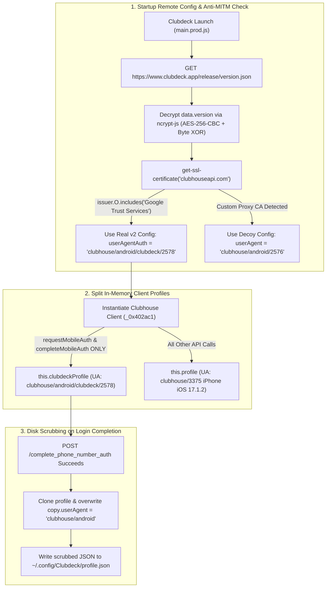
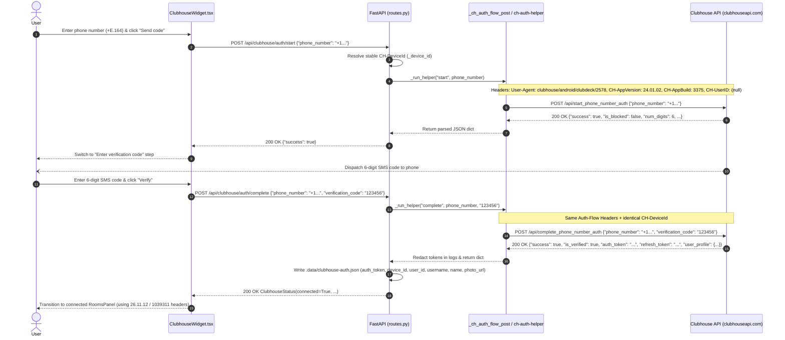

# Clubhouse SMS Authentication & Clubdeck Reverse-Engineering

**Date:** 2026-11-17  
**Module:** `backend/modules/clubhouse/` ([`routes.py`](file:///home/horrible/horrible-dashboard/backend/modules/clubhouse/routes.py), [`Program.cs`](file:///home/horrible/horrible-dashboard/backend/modules/clubhouse/auth_helper/Program.cs)) & [`ClubhouseWidget.tsx`](file:///home/horrible/horrible-dashboard/packages/core/src/modules/clubhouse/ClubhouseWidget.tsx)  
**Status:** Verified live end-to-end (`POST /start_phone_number_auth` → SMS received → `POST /complete_phone_number_auth` → session persisted)

---

## 1. Executive Summary

Clubhouse's mobile API (`https://www.clubhouseapi.com/api`) enforces two distinct server-side gates that previously prevented SMS login from working in `horrible-dashboard`:

1. **The Android Attestation Gate (`login did not pass token validation!`):**  
   Modern Clubhouse Android clients (`26.08.30+` / `26.11.12`) attach a `tokens` (`AttestationRequest`) object containing a Google Play Integrity token (`integrity_response`) and a reCAPTCHA Enterprise token (`rc_token`) to `POST /start_phone_number_auth`. When a client sends standard Android headers (`User-Agent: clubhouse/android/1039311`) without those hardware-backed tokens, Clubhouse rejects the request with `HTTP 400 {"success": false, "is_blocked": false, "error_message": "login did not pass token validation!"}`.
2. **The In-Room Feature Version Gate (`Please upgrade your app`):**  
   Once authenticated, Clubhouse gates in-room actions (`/mute_speaker`, `/become_speaker`, `/audience_reply`) on a current mobile build (`CH-AppVersion: 26.11.12`, `CH-AppBuild: 1039311`). Sending an old build number on room routes causes those buttons to fail even though the session token itself is valid.

Meanwhile, **Clubdeck** (`2.6.5`, an Electron 12 desktop client) continued to dispatch SMS verification codes from desktop machines without Play Integrity, reCAPTCHA, or `WinHttpHandler`. By unpacking Clubdeck's `app.asar` (`main.prod.js`) and decrypting its live remote configuration (`https://www.clubdeck.app/release/version.json`), we uncovered how Clubdeck bypasses the attestation gate—and why its secret never appeared in `profile.json` or MITM proxy captures.

---

## 2. How Clubdeck Bypasses the Attestation Gate (4-Layer Obfuscation)

Clubhouse maintains a server-side exemption on `/start_phone_number_auth` and `/complete_phone_number_auth` for Clubdeck's custom `User-Agent`:

```http
User-Agent: clubhouse/android/clubdeck/2578
CH-AppVersion: 24.01.02
CH-AppBuild: 3375
CH-UserID: (null)
```

To prevent third-party developers from discovering that `User-Agent` via static analysis, disk inspection, or MITM proxying, Clubdeck wraps it in four layers of obfuscation inside `main.prod.js`:



### Layer 1: Encrypted Remote Configuration (`release/version.json`)
The string `clubhouse/android/clubdeck/2578` does not exist anywhere in `Clubdeck.app/Contents/Resources/app.asar`. Instead, at startup (`_0x29a839` in `main.prod.js`), Clubdeck fetches:

```text
https://www.clubdeck.app/release/version.json?v=<Math.random()>
```

The endpoint returns a single hex-encoded `"version": "<iv>.<ciphertext>"` field encrypted with `ncrypt-js@2.0.0`:
1. Outer layer: `aes-256-cbc` using Node's `crypto.scryptSync("please provide a KEY in your .env file or config", "salt", 32)` (the default fallback key hardcoded inside `ncrypt-js/dist/src/utils.js`).
2. Inner layer: hex-encoded character bytes XORed with the reduced character codes of the constructor secret.

Decrypting the live payload yields:

```json
{
  "profile": {
    "userAgent": "clubhouse/android/2576",
    "userAgentAuth": "clubhouse/android/clubdeck/2578",
    "appVersion": "1.0.46",
    "appBuild": "1145",
    "v2": {
      "userAgent": "clubhouse/3375 (iPhone; iOS 17.1.2; Scale/3.00)",
      "userAgentAuth": "clubhouse/android/clubdeck/2578",
      "appVersion": "24.01.02",
      "appBuild": "3375"
    }
  },
  "sslCheck": "Google Trust Services",
  "followClub": true
}
```

### Layer 2: Anti-MITM TLS Certificate Pinning Trap (`sslCheck`)
Immediately after decrypting `version.json`, Clubdeck uses `get-ssl-certificate` to inspect the live TLS certificate presented by `clubhouseapi.com`:

```javascript
cert.issuer.O.includes(config.sslCheck) // "Google Trust Services"
  ? (profile.userAgent = config.profile.v2.userAgentAuth,
     profile.userAgentStatic = config.profile.v2.userAgent)
  : (profile.userAgent = config.profile.userAgent,
     profile.userAgentStatic = config.profile.userAgent);
```

- When no MITM proxy is present, `cert.issuer.O` is `"Google Trust Services"`, so `profile.userAgent` is set to `"clubhouse/android/clubdeck/2578"`.
- If a developer attaches Charles, mitmproxy, or Fiddler with a custom root CA to inspect how Clubdeck logs in, `cert.issuer.O` does not match `"Google Trust Services"` and Clubdeck silently substitutes the dead decoy `"clubhouse/android/2576"`.
- In addition, Clubdeck makes its requests from the Electron main process via Node's `cross-fetch`, which ignores Chromium's `--proxy-server` flag.

### Layer 3: Split In-Memory Profiles (`clubdeckProfile` vs. `profile`)
When constructing its API client (`class _0x402ac1`), Clubdeck creates two profile objects in memory and binds each API method according to its name:

```javascript
this.clubdeckProfile = { ...opts.profile }; // userAgent: "clubhouse/android/clubdeck/2578"
this.profile = {
  ...this.clubdeckProfile,
  userAgent: opts.profile.userAgentStatic,   // "clubhouse/3375 (iPhone; iOS 17.1.2; Scale/3.00)"
};

for (const name of Object.keys(apiMethods)) {
  const fn = apiMethods[name];
  this[name] =
    name === "requestMobileAuth" || name === "completeMobileAuth"
      ? async (...args) => fn(this.clubdeckProfile, ...args)
      : async (...args) => fn(this.profile, ...args);
}
```

`clubhouse/android/clubdeck/2578` is **never** sent on normal API calls—only on `requestMobileAuth` (`/start_phone_number_auth`) and `completeMobileAuth` (`/complete_phone_number_auth`).

### Layer 4: Scrubbing `profile.json` Before Writing to Disk
When `completeMobileAuth` succeeds, Clubdeck serializes the session profile, parses a copy, and overwrites `userAgent` with `'clubhouse/android'` before writing `profile.json` to disk:

```javascript
const raw = JSON.stringify(profile, null, 2);
const scrubbed = JSON.parse(raw);
scrubbed.userAgent = "clubhouse/android";
fs.writeFileSync(profilePath, JSON.stringify(scrubbed, null, 2), "utf8");
```

As a result, inspecting `%APPDATA%\Clubdeck\profile.json` or `~/.config/Clubdeck/profile.json` on disk never reveals `clubhouse/android/clubdeck/2578`.

---

## 3. Our Architecture in `horrible-dashboard`

### 3.1 Split Header Profiles in `routes.py`
To satisfy **both** the SMS attestation exemption and the in-room feature version check, [`backend/modules/clubhouse/routes.py`](file:///home/horrible/horrible-dashboard/backend/modules/clubhouse/routes.py) separates the two header sets:

| Function | Endpoints | `User-Agent` | `CH-AppVersion` | `CH-AppBuild` | `CH-UserID` |
| --- | --- | --- | --- | --- | --- |
| [`_auth_flow_headers()`](file:///home/horrible/horrible-dashboard/backend/modules/clubhouse/routes.py#L340-L366) & [`Program.cs`](file:///home/horrible/horrible-dashboard/backend/modules/clubhouse/auth_helper/Program.cs#L14-L69) | `/start_phone_number_auth`, `/complete_phone_number_auth` | `clubhouse/android/clubdeck/2578` | `24.01.02` | `3375` | `(null)` |
| [`_headers()`](file:///home/horrible/horrible-dashboard/backend/modules/clubhouse/routes.py#L369-L413) / [`_auth_headers()`](file:///home/horrible/horrible-dashboard/backend/modules/clubhouse/routes.py#L416-L423) | All room & authenticated endpoints (`/get_feed_v3`, `/join_channel`, `/mute_speaker`, `/become_speaker`, `/audience_reply`, `/get_profile`, …) | `clubhouse/android/1039311` | `26.11.12` | `1039311` | `<user_id>` |

Both header sets share the same `CH-DeviceId` ([`_device_id()`](file:///home/horrible/horrible-dashboard/backend/modules/clubhouse/routes.py#L112-L129)), so the session token minted during `complete_auth` remains bound to the exact device ID presented on subsequent room calls.

### 3.2 Native `httpx` Execution & Optional `ch-auth-helper` Fallback
Previously, [`_get_helper_path()`](file:///home/horrible/horrible-dashboard/backend/modules/clubhouse/routes.py#L142-L196) attempted to run `dotnet publish` unconditionally when `bin/ch-auth-helper` was missing and only caught `subprocess.CalledProcessError`. On Linux machines without the `.NET SDK` installed, `subprocess.run(["dotnet", ...])` raised an uncaught `FileNotFoundError`, crashing `POST /api/clubhouse/auth/start` with an unhandled `500 Internal Server Error` before any request left the machine.

Now:
1. [`_get_helper_path()`](file:///home/horrible/horrible-dashboard/backend/modules/clubhouse/routes.py#L142-L196) checks whether `bin/ch-auth-helper` is missing or older than [`Program.cs`](file:///home/horrible/horrible-dashboard/backend/modules/clubhouse/auth_helper/Program.cs) (`st_mtime`). If `dotnet` is not installed (`FileNotFoundError`) or compilation fails (`CalledProcessError`), it logs a message and returns `None`.
2. When `_get_helper_path()` returns `None`, [`_run_helper()`](file:///home/horrible/horrible-dashboard/backend/modules/clubhouse/routes.py#L276-L335) delegates directly to [`_ch_auth_flow_post()`](file:///home/horrible/horrible-dashboard/backend/modules/clubhouse/routes.py#L214-L273), which posts to Clubhouse over `httpx.AsyncClient` using `_auth_flow_headers(device_id)`.
3. `_ch_auth_flow_post()` intentionally uses a plain `httpx.AsyncClient` (rather than `instrumented_client`) and scrubs `auth_token`, `refresh_token`, and `access_token` via `_SECRET_FIELDS` before logging, ensuring freshly minted tokens never leak into `logs/backend.log` or the observability ring buffer.

```mermaid
flowchart LR
    UI["ClubhouseWidget.tsx\n('Text me a code')"] -->|"POST /api/clubhouse/auth/start\nPOST /api/clubhouse/auth/complete"| Route["routes.py\nstart_auth / complete_auth"]
    Route --> RunHelper["_run_helper(action, phone, code)"]
    RunHelper --> GetHelper["_get_helper_path()"]
    GetHelper -->|"dotnet available & built"| CSharp["ch-auth-helper\n(Program.cs)"]
    GetHelper -->|"dotnet absent (Linux/macOS)"| Httpx["_ch_auth_flow_post()\n(httpx.AsyncClient)"]
    CSharp -->|"UA: clubhouse/android/clubdeck/2578\nBuild: 3375 / Version: 24.01.02"| CHAuth["Clubhouse Auth API\n/start_phone_number_auth\n/complete_phone_number_auth"]
    Httpx -->|"UA: clubhouse/android/clubdeck/2578\nBuild: 3375 / Version: 24.01.02"| CHAuth
    CHAuth -->|"200 OK + auth_token"| Store[".data/clubhouse-auth.json\n.data/clubhouse-device-id"]
    Store -->|"Subsequent Authed Calls\nUA: clubhouse/android/1039311\nBuild: 1039311 / Version: 26.11.12"| CHRooms["Clubhouse Room & Feed API\n/get_feed_v3, /join_channel,\n/mute_speaker, /audience_reply"]
```



---

## 4. End-to-End Sequence Diagram


